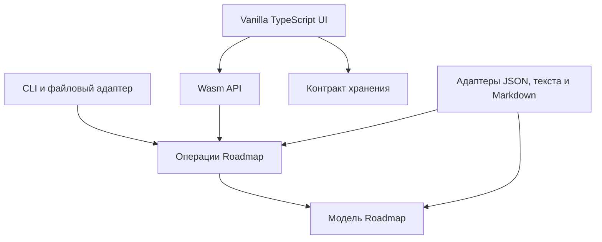

> Дополнение от 2026-11-14: [hmap-authoring.plan.md](hmap-authoring.plan.md) задаёт текущий авторский выпуск Stage 15–18 по прямому поручению владельца. Для форм и упрощённой рабочей страницы оно уточняет исторические ограничения §1.1, §14.3–14.5 и §22.6. Схема 2 и предметные контракты сохраняются.

# IRONCREED Roadmap Editor — Горизонтальная карта проявлений

**Подробное учебное ТЗ: C++20, консольный интерфейс, ввод для LLM, WebAssembly и публичный встраиваемый веб-редактор**

Редакция: **0.3.0-draft**, 8 сентября 2026 года. Основание: предоставленный `roadmap-editor.plan.md`, редакция **0.2.0**, от 21 июня 2026 года, и текущие требования автора. Рабочее имя CLI: **`hmap`**. Основную реализацию пишет автор проекта; ChatGPT/Codex помогает подготовить среду, объясняет, проверяет код и разбирает ошибки. Программный продукт при составлении этого документа не создавался. Примеры команд ниже описывают будущие контракты.


**Навигация:**

- [§ 0. Основания, приоритеты и навигация](#section-0)
- [§ 1. Оценка исходного ТЗ](#section-1)
- [§ 2. Результаты продукта и сценарии использования](#section-2)
- [§ 3. Архитектура и организация проекта](#section-3)
- [§ 4. Среда и учебный режим](#section-4)
- [§ 5. Модель данных: RoadmapProject, схема 2](#section-5)
- [§ 6. Форматы, импорт и сохранение источника](#section-6)
- [§ 7. Удобство для LLM](#section-7)
- [§ 8. CLI: обязательный контракт](#section-8)
- [§ 9. Проверки и диагностика](#section-9)
- [§ 10. Консольное и литературное представления](#section-10)
- [§ 11. Справка, подсказки и профили терминологии](#section-11)
- [§ 12. WebAssembly: ранняя проверка и окончательный API](#section-12)
- [§ 13. Хранение: CLI, Memory и LocalStorage](#section-13)
- [§ 14. Публичный встраиваемый веб-редактор](#section-14)
- [§ 15. Работа на статическом сайте](#section-15)
- [§ 16. Ограничения ресурсов и переносимость](#section-16)
- [§ 17. PLW, Конституция кода и лицензирование](#section-17)
- [§ 18. Сборка, зависимости и воспроизводимая проверка](#section-18)
- [§ 19. Миграция исходной схемы 1](#section-19)
- [§ 20. Пошаговая программа реализации для автора](#section-20)
- [§ 21. Матрица приёмки первого выпуска](#section-21)
- [§ 22. Предусмотренное развитие после MVP](#section-22)
- [§ 23. Defaults, решения перед подготовкой и контроль полноты](#section-23)
- [§ 24. Источники и фиксация редакций](#section-24)


<a id="section-0"></a>

## 0. Основания, приоритеты и навигация

### 0.1. Что прочитано

Полностью прочитан приложенный план `roadmap-editor.plan.md`. Дополнительно восстановлена концепция карты по разделу 15 исследовательского черновика `code_constitution_zenodo_full_draft_ru(1).md`: намерение проводится через элементы системы к результату; элементы переиспользуются; трудоёмкость, календарное время, неопределённость и постоянные намерения требуют отдельных понятий. Полный текст связанной беседы по URL остался недоступен, поэтому дословное восстановление остальных реплик не заявляется. Для технической переработки теперь имеется прямой исходный документ.

Прочитаны README, регламент разработки и проектный профиль `code-constitution`, README и лицензия `repository-licensing-policy`, README `prompt-literate-workflow`. Технические решения проверены по официальной документации Emscripten, CMake и выбранных библиотек. Точные редакции и ссылки перечислены в разделе 24.

### 0.2. Два канонических источника разных предметов

**План разработки** — принятый человеком `roadmap-editor.plan.md` и его контракты: он определяет, что и в каких границах реализуется. **Данные пользовательской карты** — `RoadmapProject JSON`: они определяют текущее содержание конкретной карты. Эти источники относятся к разным предметам. Markdown-экспорт карты, текстовая псевдографика и сообщение LLM становятся кандидатами или производными представлениями данных.

Ввод для LLM получает формальный текстовый протокол. Его импорт создаёт кандидат `RoadmapProject`, который проходит проверку. Поддерживается один принятый JSON-документ карты. Одновременное независимое редактирование JSON и его Markdown-проекции с автоматическим слиянием в MVP не предусматривается.

### 0.3. Что сохраняется и что изменяется

| Положение исходного плана 0.2.0 | Решение редакции 0.3.0 |
| --- | --- |
| Публичный встраиваемый пакет | Сохранено; CLI и Web используют общий движок |
| PLW template/full-copy как исходная основа | Сохранено; локальная адаптация описана явно |
| JSON как канонические данные | Сохранено |
| Vanilla TypeScript UI, без React/Vue/Svelte | Сохранено |
| Ядро без DOM, storage, Markdown и Electron | Сохранено; ядро реализуется на C++20 |
| Веб-MVP как первый шаг | Изменено текущим запросом: сначала полезная CLI, затем веб-оболочка |
| `packages/core`, `storage`, `markdown`, `ui` | Ответственности сохранены; имена уточняются до предметных, добавляется CMake-контур |
| Сверху literate view, снизу один маршрут | Сохранено |
| Отсутствие правой панели, Canvas и нескольких рядов маршрутов | Сохранено |
| LocalStorage по умолчанию в браузере; Memory для тестов | Сохранено; для CLI добавляется файловый адаптер |
| Кнопка импорта — заглушка | Расширено: реальный импорт JSON и формального текста нужен для работы с LLM |
| Только `estimate.label` и confidence | Уточнено: текстовые, неизвестные и числовые оценки различаются; автоматические суммы отложены до модели работ |
| Необязательные тесты при наличии инфраструктуры | Изменено: проверки модели, CLI, хранения и native/Wasm обязательны |
| Codex пишет весь MVP | Изменено текущим запросом: автор пишет основной код в учебных итерациях |
| Синхронный `createRoadmapEditor` | Изменено: асинхронная инициализация для Wasm, явный контракт жизненного цикла |

Эти изменения входят в новую проектную редакцию. Универсальный метод PLW и внешние нормативные репозитории ими не редактируются.

### 0.4. Как читать задание

Для первого знакомства достаточно разделов 1–4 и карточек этапов в разделе 20. Во время программирования используются контракты разделов 5–19. Приёмка и открытые решения находятся в разделах 21–24. Раздел 22 отдельно описывает следующий уровень модели, чтобы сложные оценки и постоянные намерения имели предусмотренное продолжение без раздувания первого выпуска.

В этом документе **MVP** означает завершённую последовательность CLI → Wasm → web-demo с функциями исходного плана и необходимым импортом. **Расширение** означает функцию следующего выпуска. Подготовка среды выполняется ассистентом после отдельного запроса автора; текущая задача ограничена техническим заданием.

<a id="section-1"></a>

## 1. Оценка исходного ТЗ

### 1.1. Общий вывод

Исходный план здрав как продуктовый каркас. Он задаёт ясные границы интерфейса, каноническую модель, сменное хранилище и способ публичного встраивания. Его подробности ориентированы на быстрый TypeScript-прототип. Для начинающего C++-разработчика требуется отдельное описание типов, владения памятью, сборки, диагностик, форматов, порядка реализации и проверки каждого шага.

| Место исходника | Подводный камень | Уточнение этого ТЗ |
| --- | --- | --- |
| `selectedIntentId`, несколько routes | Намерение может иметь несколько маршрутов; выбор неоднозначен | Добавлен `selectedRouteId`, правила согласованности и пустого состояния |
| Массивы + `order` | Два источника порядка | В схеме 2 порядок задаёт массив; миграция схемы 1 разбирает `order` явно |
| `linked*Ids` | Непонятны типы ссылок, дубли и удаление цели | Глобальные стабильные ID, типизированная проверка, атомарное отклонение сломанного проекта |
| `EstimateEntry.label` | Строки `2–4 h` и `2–4 d` не задают вычислительную модель | Тип оценки, единица, диапазон, причина неизвестности; в MVP показываем оценки без общего срока |
| `shared` и intersections | Повторное появление модуля можно принять за повторное создание | Шаг — конкретное вхождение; модуль — общий объект; суммы требуют отдельной идентичности работы |
| `LocalStorageAdapter` | Ошибки квоты, запрета storage, повреждения и нескольких вкладок | Явные ошибки, сохранение последнего корректного состояния, предупреждение о временной памяти |
| `createRoadmapEditor` | Не описаны загрузка, ошибки и уничтожение | Асинхронная фабрика, готовность движка, правило владения Worker, отклонённые Promise |
| Literate Source View | Заголовок создаёт ожидание полноценного редактирования Markdown | В MVP это представление JSON; ввод идёт через импорт кандидата |
| Markdown → contracts → prompt | Экспортированный красивый план может не содержать реальных критериев | Проверка содержательной комплектности PLW-пакета; пустые контракты не объявляются готовыми |
| `npm install` и необязательные тесты | Воспроизводимость и поведение не закреплены | `npm ci`, pinned C++-зависимости, обязательные контрактные проверки |
| Оценки реализации | Не включают обучение и портирование | Старые оценки сохраняются как исторические, новые уточняются после первых учебных этапов |

Сумма интервалов девяти шагов исходного Road View составляет **29–47 часов**. Это арифметика исходных оценок, а не проверенный срок. Значение `2–4 d` в Repository Route не определяет длительность рабочего дня и не эквивалентно автоматически этому диапазону. Для C++-реализации под руководством ассистента срок устанавливается после измерения первых завершённых модулей.

### 1.2. Выбор языка

C++20 подходит для этой задачи: программа имеет компактную модель, обработку текста, проверки связей и несколько способов вывода. Общий движок можно собирать для native и Wasm. Дополнительная цена — изучение владения ресурсами, двух целей компиляции и пограничных вызовов. Выбор C++ здесь оправдан учебной целью и переиспользованием ядра; преимущество скорости относительно TypeScript заранее не обещается.

Рабочая последовательность: **C++-модель → небольшая CLI → ранняя проверка Wasm → законченная CLI и протокол LLM → vanilla TypeScript web-demo**. Полноэкранный терминальный редактор имеет отдельный этап расширения. Консольная псевдографика доступна командой просмотра уже в MVP.

### 1.3. Главные ограничения

Общий движок не знает о терминале, DOM, Electron, LocalStorage, сетевых API и расположении файлов на диске. Путь на карте показывает последовательность сценария; зависимости реализации и календарный план требуют самостоятельных связей. Статус `implemented` является заявлением автора, которое программа может структурно проверить; подтверждение содержания сохраняет человеческого адресата.

<a id="section-2"></a>

## 2. Результаты продукта и сценарии использования

1. Автор создаёт или получает от LLM файл JSON либо RoadmapText/1.
2. CLI проверяет синтаксис и модель и сообщает, какое поле и почему нужно исправить.
3. Автор получает литературный текст и одно выбранное горизонтальное представление маршрута.
4. Общий модуль виден в разных шагах по одному ID; текстовые оценки сохраняются без недостоверного суммирования.
5. Справка объясняет команды; методические подсказки отдельно объясняют смысл понятий и незаполненные вопросы.
6. JSON сохраняется в файл; Markdown остаётся экспортом.
7. Тот же JSON обрабатывается тем же C++-движком в браузере.
8. Web-demo показывает literate view сверху и один маршрут снизу, импортирует кандидата, сохраняет его в LocalStorage и позволяет скачать файл.
9. Другой сайт встраивает редактор через публичную фабрику, передаёт storage и движок, а затем корректно уничтожает экземпляр.

В MVP отсутствуют Canvas, несколько видимых рядов маршрутов, боковой inspector, дерево файлов, перетаскивание графа, облачная синхронизация, авторизация, встроенная генерация ИИ и Electron-зависимости. Импорт документа карты, добавленный текущим запросом, отличается от отложенного импорта отдельных модулей из внешнего каталога.

<a id="section-3"></a>

## 3. Архитектура и организация проекта

### 3.1. Направления зависимостей

Стрелка означает зависимость исходного кода. Конкретные адаптеры соединяются во внешних точках сборки.



В модели находятся сущности и правила их согласованности. Прикладной уровень связывает операции разбора, проверки и подготовки результата. Адаптеры переводят JSON и текст в модель, строят представления и обеспечивают внешние действия. CLI и Web получают одинаковые правила карты через общий движок.

### 3.2. Целевая карта каталогов

| Путь | Ответственность |
| --- | --- |
| `packages/roadmap-core/src/roadmap/domain/` | C++-типы, ссылки, состояния, правила |
| `packages/roadmap-core/src/roadmap/application/` | Проверка проекта, выбор маршрута, прикладные результаты |
| `packages/roadmap-formats/src/` | JSON, RoadmapText/1, текстовый и Markdown-экспорт |
| `packages/roadmap-guidance/` | Каталог помощи и правила подбора вопросов |
| `packages/roadmap-wasm/` | Пограничный API, Embind, сборка модуля |
| `packages/roadmap-storage/src/` | TypeScript-контракт, Memory и LocalStorage |
| `packages/roadmap-ui/src/` | Встраиваемая vanilla TypeScript UI |
| `apps/roadmap-cli/` | `main.cpp`, команды, файлы, composition root |
| `apps/web-demo/` | Потребитель UI; выбор стандартных адаптеров |
| `test/fixtures/` | Положительные и отрицательные JSON/текстовые образцы |
| `docs/lessons/`, `docs/decisions/`, `docs/guidance/` | Учебные карточки, решения, каноническая помощь |
| `schema/`, `manifest/`, `governance/` | Схемы, происхождение, версии и проектные правила |
| `cmake/`, `tools/` | Сборка, зависимости и контрольные команды |
| `build/`, `dist/` | Производные сборочные и поставляемые файлы |

Названия сохраняют ответственности исходных `core/storage/markdown/ui`, одновременно обозначая предмет. Пакет здесь означает единицу ответственности и сборки; публикация каждого каталога в npm не требуется. Пустые модули «на будущее» создавать не нужно.

Семантическая иерархия и границы соответствуют прочитанным BASE-N03 и BASE-A01–A02: [регламент code-constitution](https://github.com/FOP-Oksana-Dubinetska/code-constitution/blob/220dc9c286ae06f8b6ed60cdda75112eed0408ed/governance/legislation/DEVELOPMENT.md). Языковой профиль C++ принимается отдельно.

### 3.3. Публичные C++-границы

Модель использует собственные структуры и стандартную библиотеку. `nlohmann::json`, `emscripten::val`, файловые объекты и события терминала остаются в адаптерах. Чистые функции получают всё необходимое в аргументах. Интерфейс-порт вводится для реальной заменяемой внешней зависимости; отдельный интерфейс для каждой небольшой функции не требуется.

Типы C++ передаются по значению либо через `const T&` по правилам владения. Связи между объектами хранятся как ID. Индексы ускоряют поиск, но не владеют смыслом данных. Программа не сохраняет адрес элемента `std::vector` как долговременную связь: перераспределение памяти сделает такой адрес недействительным.

<a id="section-4"></a>

## 4. Среда и учебный режим

| Компонент | Выбор |
| --- | --- |
| Ядро | C++20, без расширений компилятора |
| Первая ОС разработки | WSL2/Linux; другой вариант фиксируется до подготовки |
| Native toolchain | Один выбранный GCC либо Clang, CMake, Ninja, GDB либо LLDB |
| C++-проверки | Catch2 + CTest, clang-format; clang-tidy по принятому набору |
| JSON | nlohmann/json в адаптерах |
| Wasm | Закреплённый Emscripten SDK, отдельная сборка |
| Web | Vanilla TypeScript, CSS, Vite, npm workspaces |
| Опциональный TUI позже | FTXUI после проверки поведения на целевых терминалах |

Точные версии устанавливаются при подготовке среды и записываются в манифест. `latest` и плавающая ветка внешней зависимости не используются в воспроизводимом выпуске. CMake Presets задают общие сценарии конфигурации, сборки и тестов; личные пути остаются в игнорируемом `CMakeUserPresets.json`. Основание: [CMake Presets](https://cmake.org/cmake/help/latest/manual/cmake-presets.7.html).

### 4.1. Необходимый словарь C++

| Термин | Значение в этой работе |
| --- | --- |
| `.hpp` | Объявления типов и доступных функций |
| `.cpp` | Реализация объявленного поведения |
| Компиляция / линковка | Получение объектных файлов / их соединение с библиотеками |
| `struct` / `enum class` | Связанные значения / ограниченный набор вариантов |
| `std::vector` | Владеющая последовательность значений |
| `std::string` | Владеющая строка байтов; размер UTF-8 в байтах отличается от экранной ширины |
| `const T&` | Чтение существующего значения без копии и без владения |
| `std::optional<T>` | Значение присутствует либо отсутствует |
| `std::variant` | Один из нескольких явно разрешённых типов |
| RAII | Освобождение ресурса при завершении жизни владельца |
| DTO | Простая структура результата на границе частей программы |
| Undefined behavior | Ситуация, для которой язык не гарантирует поведение |

`std::expected` относится к C++23. В профиле C++20 ожидаемые ошибки выражаются именованным результатом с `std::optional` и диагностикой. Ручное управление памятью через `new/delete`, собственные контейнеры и сложное метапрограммирование на начальных этапах не требуются.

### 4.2. Правило учебной итерации

Одна итерация даёт одну понятную цель, перечень файлов, небольшой пример, реализацию автора и наблюдаемую проверку. Ассистент объясняет контракт до кода и разбирает ошибки после попытки автора. Целый учебный модуль ассистент пишет по прямому запросу. Инфраструктурная подготовка может быть выполнена ассистентом полностью по отдельному поручению.

Ревью различает дефект поведения, риск памяти, нарушение принятой архитектурной границы и предпочтение оформления. Для каждой обязательной правки приводится причина. Следующий этап начинается после понятного автору работающего результата предыдущего.

<a id="section-5"></a>

## 5. Модель данных: RoadmapProject, схема 2

### 5.1. Причина новой версии

Исходный план объявляет `schemaVersion: 1`. Эта редакция уточняет порядок, выбор маршрута, постоянные намерения и оценки, поэтому предлагает **схему 2**. Новая форма не выдаётся за старую. Формат файла — UTF-8 JSON; рекомендуемое расширение **`.roadmap.json`**. Схема 1 читается только явной командой миграции. Отсутствующая либо неизвестная версия вызывает ошибку с объяснением.

В репозитории создаётся `schema/roadmap-project-v2.schema.json`. Она описывает форму данных для редакторов и автоматических проверок. Ссылки между объектами, согласованность выбора и смысл состояний проверяет C++-валидатор. JSON Schema не заменяет эти проверки.

### 5.2. Общие правила

Все ID проекта, намерений, маршрутов, шагов, модулей, чанков, пересечений и оценок уникальны во всём документе. Рекомендуемые префиксы: `p-`, `i-`, `r-`, `s-`, `m-`, `c-`, `x-`, `e-`. Префикс помогает читателю; фактический тип определяется записью. Разрешены ID длиной 1–64 ASCII-символа, соответствующие `[a-z][a-z0-9]*(?:-[a-z0-9]+)*`. Регистрозависимые машинные ключи не переводятся.

Название может меняться при сохранении ID. Программа не объединяет объекты по одинаковому названию. В первой версии редактирование ID требует исправления всех ссылок в одном кандидате проекта; частично обновлённый документ не принимается.

Порядок намерений, маршрутов, шагов, модулей, чанков, пересечений и оценок задаётся порядком соответствующего массива. Поле `order` в схеме 2 отсутствует. Сортировка по ID используется только в явно запрошенном отчёте и не меняет порядок источника.

Поля, перечисленные ниже без отметки «необязательно», присутствуют в каноническом JSON. Пустой массив обозначает отсутствие связей; `null` используется только в прямо разрешённых местах. Неизвестные поля отклоняются. Будущие расширения получают новую редакцию схемы и процедуру миграции.

### 5.3. Корневой объект

| Поле | Тип и правило |
| --- | --- |
| `schemaVersion` | Целое число `2` |
| `id`, `title` | ID и непустое название проекта |
| `terminologyProfile` | `engineering`, `simple`, `product`, `literary` |
| `intents` | Массив `IntentNode` |
| `selectedIntentId` | ID существующего намерения либо `null` |
| `selectedRouteId` | ID существующего маршрута либо `null` |
| `routes` | Массив `IntentRoute` |
| `modules` | Массив `RoadmapModule` |
| `chunks` | Массив `LiterateChunk` |
| `intersections` | Массив `RoadmapIntersection` |
| `estimates` | Массив `EstimateEntry` |
| `metadata` | `formatVersion`, `createdAt`, `updatedAt` |

`metadata.formatVersion` для этого профиля равен `2.0.0`. `createdAt` и `updatedAt` — RFC 3339 UTC с суффиксом `Z` либо `null` для ещё не датированного черновика. Импорт, просмотр, нормализация и экспорт сохраняют эти значения. Операция пользовательского сохранения получает момент от внешнего Clock и устанавливает `updatedAt`; при `createdAt: null` устанавливает также `createdAt`. В тестах Clock возвращает фиксированное значение. Программа не подставляет вымышленные даты ради прохождения схемы.

### 5.4. Намерение — IntentNode

| Поле | Правило |
| --- | --- |
| `id`, `title`, `summary` | ID, название, пояснение; пустой summary допустим для draft |
| `status` | `draft`, `active`, `implemented`, `deferred` |
| `kind` | `finite` либо `continuous` |
| `parentIntentIds` | Уникальные ID намерений, из которых возникло это намерение |
| `acceptanceCriteria` | Массив текстовых критериев результата |

Намерение выражает желаемое свойство или результат. Его родительские связи означают происхождение. Самоссылки и циклы происхождения запрещены. Статус `implemented` допустим для `finite`; постоянное `continuous` намерение остаётся `active` при действующей реализации или `deferred` при приостановке. Его первоначальная работа и последующее сопровождение рассматриваются отдельно в расширении модели.

Для active/implemented намерения пустые критерии дают предупреждение `W_ACCEPTANCE_MISSING`. Для implemented без зафиксированного объяснения приёмки в связанном chunk — методический вопрос. Программа не назначает автора приёмки автоматически.

### 5.5. Маршрут и шаг

`IntentRoute` содержит `id`, `intentId`, `title`, `steps`. `intentId` разрешается в намерение. `steps` — массив `RouteStep`. Пустой маршрут допустим как черновик и получает `W_ROUTE_EMPTY`.

`RouteStep` содержит `id`, `title`, `stereotype`, `estimateId`, `linkedModuleIds`, `linkedChunkIds`. `stereotype` сохраняет варианты исходного плана: `intent`, `module`, `shared`, `validation`, `export`. `estimateId` содержит ID оценки либо `null`. Остальные ссылки — массивы уникальных ID нужного типа.

Шаг принадлежит ровно одному маршруту, поскольку вложен в его `steps`. Два появления одного модуля оформляются двумя шагами с разными ID и ссылкой на один `RoadmapModule`. Удаление шага из одного маршрута сохраняет общий модуль. Если на шаг ссылается пересечение, одновременное исправление ссылки входит в тот же кандидат изменения.

Стереотип является смысловой пометкой отображения. `shared` сам по себе не создаёт общий модуль и не является доказательством переиспользования. Отчёт определяет фактические повторные ссылки на модуль по их ID.

### 5.6. Общий элемент — RoadmapModule

Сохраняется термин `RoadmapModule` из исходного плана. Он обозначает именованный элемент проектируемой системы; один такой элемент не обязан совпадать с одним C++-файлом или классом.

| Поле | Правило |
| --- | --- |
| `id`, `title`, `summary` | Идентичность и объяснение роли |
| `kind` | `core`, `ui`, `storage`, `export`, `demo`, `validation` |
| `linkedIntentIds` | Явно заявленные смысловые связи с намерениями |
| `existence` | `planned`, `existing`, `deprecated` |
| `codeRefs` | Массив ссылок на код |

Каждый `codeRef` содержит `repository`, `path`, `revision`, `symbol`. `repository` — URL репозитория либо явно определённое локальное имя; `path` — относительный путь с `/`; `revision` — строка либо `null`; `symbol` — строка либо `null`. Для ещё не созданного элемента `codeRefs` может быть пустым.

Ссылка на код в MVP сохраняется и показывается как текст. Программа не выполняет Git-команды и не утверждает, что файл или символ существуют. Проверка конкретной ревизии кода — будущий адаптер. Нормализация не превращает `main` в вымышленный commit SHA.

`linkedIntentIds` — авторские смысловые связи. Ссылки на модуль из шагов — фактические вхождения в маршруты. Отчёт показывает оба основания отдельно, не записывая автоматически выведенные связи обратно в JSON.

### 5.7. Литературный фрагмент и пересечение

`LiterateChunk`: `id`, `name`, `body`, `linkedIntentIds`, `linkedModuleIds`. Тело хранится как строка UTF-8. Оно может содержать Markdown, именованные блоки и объяснения. Программа сохраняет этот текст; экспорт не переписывает авторские формулировки. Веб-MVP безопасно выводит текст и ограниченную разметку по разделу 14.

`RoadmapIntersection`: `id`, `title`, `sourceIds`, `note`. Массив `sourceIds` содержит не менее двух разных ID намерений, модулей, чанков или шагов. ID проекта, маршрута, оценки или другого пересечения здесь запрещён. Пересечение — авторская пометка об общей точке или связи. Автоматически найденное многократное использование модуля является отдельным вычисленным сведением.

### 5.8. Оценка — EstimateEntry

`EstimateEntry` содержит `id`, `label`, `confidence`, `basis`, `value`. `label` — авторское пояснение; числовое отображение строится из `value`. `confidence` принимает `low`, `medium`, `high`; это субъективная уверенность автора, без автоматического вероятностного смысла. `basis` описывает основание оценки; пустое значение допускается с предупреждением.

`value` имеет ровно одну из форм:

```json
{"type":"range","metric":"effort","minMinutes":120,"maxMinutes":240}
```

```json
{"type":"range","metric":"elapsed","minMinutes":1440,"maxMinutes":2880}
```

```json
{"type":"unknown","reason":"Не проверен формат данных внешнего модуля"}
```

```json
{"type":"not-applicable","reason":"Постоянное требование; здесь нет конечного срока"}
```

```json
{"type":"text","text":"2–4 d; длина рабочего дня в старом плане не определена"}
```

Для `range` разрешены целые числа от 0 до 1 000 000 000, причём минимум не превышает максимум. `effort` измеряется в человеко-минутах; `elapsed` — в минутах календарной длительности. Для unknown/not-applicable причина непустая. Форма `text` сохраняет наследованные или ещё не формализованные оценки. Её нельзя молча преобразовать в диапазон.

В MVP оценка — аннотация шага. Один `estimateId` может использоваться несколькими шагами как одна авторская запись, но это не задаёт идентичность работы. Поэтому общего итога по шагам, модулям или проекту **нет**. Отчёт показывает видимые оценки, их смысл и пробелы. Расчёты без двойного учёта требуют модели работ из раздела 22.

### 5.9. Выбранный маршрут и пустое состояние

Если `selectedIntentId` равен `null`, `selectedRouteId` также равен `null`. Если выбран маршрут, его `intentId` совпадает с выбранным намерением. Выбранное намерение без маршрутов допустимо; тогда `selectedRouteId` равен `null`, а нижняя область показывает пустое состояние.

Если намерение имеет маршруты, но `selectedRouteId` равен `null`, проект остаётся корректным: пользователь ещё не выбрал маршрут. Команда просмотра с `--route` явно задаёт выбор. Команда без выбора выводит объяснение, а не берёт первый случайный маршрут. Начальный пример содержит оба ID, поэтому показывается сразу. В UI выбор другого намерения сбрасывает выбранный маршрут; если у намерения ровно один маршрут, UI может выбрать его явной операцией состояния и уведомить `onChange`.

<a id="section-6"></a>

## 6. Форматы, импорт и сохранение источника

### 6.1. Три разных представления

| Представление | Назначение | Можно ли использовать как источник данных приложения |
| --- | --- | --- |
| `RoadmapProject JSON`, схема 2 | Сохранение, перенос, обмен между CLI и Web | Да, каноническая модель |
| `RoadmapText/1`, `.roadmap.txt` | Понятный ввод для человека и LLM со стрелками | Через явный импорт и проверку кандидата |
| Литературный Markdown, `.md` | Чтение, публикация, PLW-проекция | Только как производный документ в MVP |
| Терминальные рамки | Просмотр одного маршрута | Только представление |

RoadmapText не заменяет JSON и не является произвольным Markdown. Программа не извлекает неизвестную схему из свободного эссе. У формального протокола есть версия, грамматика и обратимый экспорт. Геометрия рамок не входит в язык данных.

### 6.2. JSON-граница

Разбор выполняется строгим JSON-парсером. Дубликаты ключей запрещены: `{"title":"A","title":"B"}` вызывает ошибку. Обычный DOM-разбор библиотеки может потерять информацию о повторе, поэтому адаптер отдельно обнаруживает дубли через поддерживаемые события парсера до построения окончательной модели. Вложенность и объём также проверяются до чрезмерного выделения памяти.

Комментарии, завершающие запятые, `NaN`, `Infinity`, лишний текст после документа и неверный UTF-8 отклоняются. Это выбранный строгий режим. Библиотека предоставляет DOM/SAX и настройки обработки ошибок: [nlohmann/json — Parsing](https://json.nlohmann.me/features/parsing/). Полная проверка модели выполняется после синтаксического разбора.

### 6.3. Грамматика RoadmapText/1

Первая значимая строка: `!roadmap-text 1`. Далее идут записи вида `keyword id { JSON-поля }`. JSON-объект может занимать несколько строк. Ключевые слова: `project`, `intent`, `route`, `step`, `module`, `chunk`, `intersection`, `estimate`.

ID задаётся после ключевого слова; поле `id` внутри объекта запрещено. Поля соответствуют одноимённой структуре схемы 2. В `project` отсутствуют коллекции `intents/routes/modules/chunks/intersections/estimates`: они собираются из записей. В `route` отсутствует `steps`: порядок шагов задаёт отдельный блок маршрута. Все остальные поля обязательны по схеме 2.

```text
route r-main {"intentId":"i-main","title":"Основной маршрут"}

<<route:r-main>>
[s-start] -> [s-check] -> [s-export]
<<end-route>>
```

Блок маршрута может содержать переносы строк между токенами. Внутри разрешены `[id]`, стрелки `->` либо `→` и пробельные символы. Обе стрелки имеют одинаковый смысл; нормализованный текст использует `->`. Пустое содержимое блока обозначает пустой маршрут. Начальная и конечная стрелки, две стрелки подряд и ссылка без скобок запрещены.

Каждая запись route имеет ровно один блок. Каждый step объявлен отдельно и встречается ровно в одном блоке ровно один раз. Порядок объявлений свободен: ссылки разрешаются после прочтения документа. Порядок коллекций берётся из порядка записей, а порядок шагов — из блока. Название шага хранится в записи step; по тексту внутри квадратных скобок ищется только ID.

Вне JSON и блоков маршрута допустимы пустые строки и комментарии, начинающиеся с `#` после пробелов. Внутри JSON комментарии запрещены; символ `#` в строке является обычным текстом. Комментарии RoadmapText не переносятся в модель. Смысловые объяснения автор помещает в `summary`, `body`, `note`, `basis` или `reason`.

Разбор JSON-блока ведётся с учётом вложенности, строк и экранирования. Символ `}` внутри строки не завершает объект. JSON разбирает библиотека; собственный небольшой сканер определяет границы записи. `eval`, выполнение shell-команд и загрузка внешних включений в грамматике отсутствуют.

### 6.4. Полный минимальный пример ввода для LLM

Пример самодостаточен и описывает проект до первой даты сохранения:

```roadmap-text
!roadmap-text 1
project p-demo {
  "schemaVersion": 2,
  "title": "Проверка карты",
  "terminologyProfile": "engineering",
  "selectedIntentId": "i-check",
  "selectedRouteId": "r-check",
  "metadata": {"formatVersion":"2.0.0","createdAt":null,"updatedAt":null}
}
intent i-check {
  "title":"Получить проверенную карту",
  "summary":"Автор получает понятное объяснение каждой ошибочной ссылки.",
  "status":"draft",
  "kind":"finite",
  "parentIntentIds":[],
  "acceptanceCriteria":["Ссылка на отсутствующий модуль вызывает E_REF_NOT_FOUND."]
}
module m-validator {
  "title":"Валидатор карты",
  "summary":"Проверяет ID и типы связей.",
  "kind":"validation",
  "linkedIntentIds":["i-check"],
  "existence":"planned",
  "codeRefs":[]
}
chunk c-validation {
  "name":"Контракт проверки",
  "body":"Валидатор возвращает диагностику и сохраняет исходный документ.",
  "linkedIntentIds":["i-check"],
  "linkedModuleIds":["m-validator"]
}
estimate e-validation {
  "label":"Первичная реализация проверки",
  "confidence":"low",
  "basis":"Первое учебное знакомство с индексом ID.",
  "value":{"type":"unknown","reason":"Трудоёмкость уточняется после первого теста."}
}
route r-check {"intentId":"i-check","title":"Проверка и получение результата"}
step s-intent {
  "title":"Сформулировать критерий",
  "stereotype":"intent",
  "estimateId":null,
  "linkedModuleIds":[],
  "linkedChunkIds":["c-validation"]
}
step s-validation {
  "title":"Проверить связи",
  "stereotype":"validation",
  "estimateId":"e-validation",
  "linkedModuleIds":["m-validator"],
  "linkedChunkIds":["c-validation"]
}
step s-export {
  "title":"Вывести результат",
  "stereotype":"export",
  "estimateId":null,
  "linkedModuleIds":[],
  "linkedChunkIds":[]
}
<<route:r-check>>
[s-intent] -> [s-validation] -> [s-export]
<<end-route>>
```

Результат импорта содержит один проект, одно намерение, один маршрут с тремя шагами, один модуль, один chunk, одну оценку и пустой массив intersections. Неизвестная оценка допустима. Она должна появиться в методическом отчёте как вопрос, сохранив причину.

### 6.5. Обратимость и детерминизм

Обязательный инвариант: `importText(exportText(project))` семантически равен `project` для любого корректного проекта схемы 2. Сравнение учитывает значения, порядок массивов, ID и авторские строки. JSON-пробелы и порядок ключей не являются смыслом. Полный Markdown-экспорт таким инвариантом не обладает.

Нормализованный JSON имеет отступ 2 пробела, LF и конечный перевод строки. Порядок ключей задаёт сериализатор; массивы сохраняют порядок. Нормализация текста выдаёт канонические ключевые слова, стрелки `->` и стабильное оформление. Комментарии и исходные отступы RoadmapText не восстанавливаются. Авторский текст в строковых полях сохраняется по Unicode-содержанию без скрытой нормализации NFC/NFKC.

Хеш файла означает хеш точных байтов. Семантическое равенство и равенство байтов проверяются отдельно. Генератор не вставляет время, случайный ID или путь рабочей директории в детерминированный экспорт.

### 6.6. Поведение импорта

Импорт полностью разбирает вход, строит кандидат, проверяет его и только затем возвращает проект. При ошибке текущий проект и существующий целевой файл сохраняются. Автоматическое исправление ID, удаление неизвестных полей и угадывание типов отсутствуют.

По умолчанию вывод идёт в stdout. При `--output` существующий файл не перезаписывается без `--overwrite`. Входной файл и выходной путь должны различаться; операция на месте в MVP отсутствует. Для преобразования своей карты автор сначала просматривает новый файл и разницу, затем принимает его как текущий.

<a id="section-7"></a>

## 7. Удобство для LLM

### 7.1. Что получает модель

Команда `hmap help llm --format=markdown` выдаёт краткий протокол: версия, допустимые записи и поля, правила ID, пример, допустимая неизвестность и команда проверки. Команда `hmap template --format=roadmap-text` выдаёт самодостаточный пример. Команда `hmap schema --format=json` выдаёт текущую JSON Schema. Вывод этих команд не требует сети.

Шаблон запроса к LLM: «Создайте кандидат RoadmapText/1 по приложенному протоколу. Сохраните выданные ID существующих объектов. Используйте unknown с причиной для неизвестных оценок. Возвращайте только документ без внешнего Markdown-ограждения. Проверьте, что каждый step принадлежит одному route и все ссылки объявлены. Не объявляйте реализацию принятой без предоставленного основания».

### 7.2. Цикл исправления

1. Автор передаёт модели актуальный экспорт и требуемое изменение.
2. Модель возвращает полный небольшой кандидат либо ограниченный набор изменений в отдельном рабочем процессе.
3. Автор сохраняет кандидат в отдельный файл.
4. `hmap validate` выдаёт машиночитаемую диагностику.
5. Модели передаются коды и указатели ошибок вместе с нужным фрагментом.
6. Повторная проверка подтверждает форму; автор просматривает смысловую разницу.
7. Принятый JSON становится текущим источником.

JSON Patch, слияние одновременно изменённых документов и потоковый частичный импорт отложены. Для небольших карт полный кандидат проще проверить. В MVP приложение не вызывает LLM и не хранит API-ключей.

### 7.3. Отношение к PLW

Создание кандидата данных карты и изменение исходного кода редактора — разные операции. Для изменения кода используется PLW-план с конкретными контрактами, сценариями и TRACE. Текст в пользовательской карте является данными; он не даёт инструменту полномочий изменять репозиторий, запускать команды или отключать проверки.

<a id="section-8"></a>

## 8. CLI: обязательный контракт

### 8.1. Команды

| Команда | Результат | Этап |
| --- | --- | --- |
| `hmap --version` | Версия программы, схемы, RoadmapText и API | 02 |
| `hmap help [topic]` | Синтаксическая и методическая помощь | 02/08 |
| `hmap template` | Корректный небольшой пример | 04 |
| `hmap schema` | JSON Schema схемы 2 | 04 |
| `hmap validate INPUT` | Структурная и смысловая диагностика | 05 |
| `hmap import INPUT` | Проверенный нормализованный JSON | 06 |
| `hmap normalize INPUT` | JSON либо RoadmapText в нормализованном виде | 06 |
| `hmap render INPUT` | Один выбранный маршрут | 07 |
| `hmap inspect INPUT --id ID` | Полные данные объекта и его использование | 07 |
| `hmap hints INPUT` | Методические вопросы по карте | 08 |
| `hmap explain CODE` | Объяснение диагностического кода | 08 |
| `hmap export INPUT` | Markdown, JSON либо RoadmapText | 10 |
| `hmap migrate INPUT --from=1 --to=2` | Кандидат новой схемы и отчёт миграции | 11 |

Импорт работает с целым документом. Команда `delete` в CLI не нужна для MVP; автор редактирует кандидат в текстовом редакторе. Веб-хранилище сохраняет предусмотренный исходным контрактом метод удаления проекта.

### 8.2. Аргументы и потоки

`INPUT` — путь или `-` для stdin. Формат задаётся `--input-format=json|roadmap-text`; при его отсутствии определение выполняется по первому значимому содержимому: `{` означает JSON, `!roadmap-text 1` означает текстовый протокол. Иной ввод требует явного корректного формата и получает ошибку. Файл с начальным BOM UTF-8 принимается после удаления только этого BOM; UTF-16 не угадывается.

`--format` означает формат результата конкретной команды. Для validate: `text|json`. Для help/explain/hints: `text|markdown|json`. Для template/normalize/export: поддерживаемое подмножество `json|roadmap-text|markdown`. Для render: `text|json`. Недопустимое сочетание получает ошибку CLI. `--output PATH`, `--overwrite`, `--lang ru|en`, `--color auto|always|never` имеют одинаковый смысл у поддерживающих их команд.

На stdout находится только запрошенный результат. Сообщения о ходе работы в stdout отсутствуют. Информационные команды validate/render/inspect/help/explain/hints с `--format=json` возвращают в stdout ровно один envelope по § 12.2, включая случаи ошибок; requestId у CLI равен null. В text-режиме ошибки идут в stderr. Команды, выдающие артефакт (schema/template/import/normalize/export/migrate), записывают в stdout только артефакт; при ошибке stdout пуст, диагностика идёт в stderr. Успешный migrate выдаёт кандидат JSON в stdout, а отчёт преобразований — в stderr. Wasm всегда использует envelope: для migrate result содержит project и migrationReport. ANSI-коды в JSON/Markdown/RoadmapText запрещены. В режиме auto цвет включается только для подходящего интерактивного терминала; `NO_COLOR` учитывается.

`--help` и `-h` возвращают код 0 без чтения карты. Неизвестная команда, неизвестный флаг, лишний позиционный аргумент или неверное значение флага дают код 2. Без аргументов выводится краткая помощь и код 0; интерактивный опрос и ожидание ввода не запускаются.

### 8.3. Коды завершения

| Код | Значение |
| --- | --- |
| `0` | Операция выполнена; предупреждения допустимы |
| `2` | Ошибка команды или её аргументов |
| `3` | Ошибка синтаксиса, схемы, модели или выбранного объекта |
| `4` | Ошибка чтения, записи, запрет перезаписи, недоступное хранилище |
| `5` | Превышение заявленного лимита ресурса |
| `6` | Неожиданная внутренняя ошибка |
| `7` | `--strict` отклонил документ только из-за предупреждений |

Ожидаемые ошибки возвращаются обычными результатами. Выход за лимит, обнаруженный до аварии выделения памяти, даёт код 5. Системное завершение процесса ОС не обещает такой управляемый код. `--strict` распространяется на предупреждения валидатора; информационные методические вопросы команды hints сами по себе не являются ошибками.

### 8.4. Примеры будущего рабочего цикла

```bash
hmap template --format=roadmap-text --output draft.roadmap.txt
hmap validate draft.roadmap.txt --format=json
hmap import draft.roadmap.txt --output demo.roadmap.json
hmap render demo.roadmap.json --route=r-check --glyphs=unicode
hmap inspect demo.roadmap.json --id=m-validator
hmap hints demo.roadmap.json --format=markdown
hmap export demo.roadmap.json --format=markdown --output demo.md
hmap explain E_REF_NOT_FOUND --lang=ru
```

Имена файлов с пробелами заключаются в кавычки. Команды выполняются в одной выбранной оболочке, первоначально Bash в WSL. Различия перенаправлений PowerShell объясняются при добавлении native Windows-поддержки.

<a id="section-9"></a>

## 9. Проверки и диагностика

### 9.1. Последовательность обработки

1. Проверить размер входа и доступность байтов.
2. Проверить кодировку и сигнатуру формата.
3. Разобрать синтаксис с лимитом вложенности и обнаружением повторных ключей.
4. Проверить версию и форму полей.
5. Построить типизированный кандидат и индекс ID.
6. Проверить типы ссылок, принадлежность шагов, выбор и граф происхождения намерений.
7. Собрать предупреждения о неполноте.
8. Выполнить запрошенную операцию над корректным проектом.
9. Полностью подготовить результат и только затем передать его внешней записи.

Синтаксическая ошибка блокирует построение модели. После успешного разбора валидатор старается сообщить несколько независимых проблем за один проход. При достижении лимита диагностик возвращает признак усечения и количество показанных записей. Сообщение «ошибок больше нет» в таком случае запрещено.

### 9.2. Минимальный реестр кодов

| Код | Условие | Что объяснить автору |
| --- | --- | --- |
| `E_INPUT_ENCODING` | Неверный UTF-8 | Сохранить файл как UTF-8 |
| `E_INPUT_LIMIT` | Превышен лимит | Указать фактический и допустимый объём |
| `E_PARSE_JSON` | Ошибка JSON | Позицию и ожидаемую конструкцию, если она известна |
| `E_PARSE_TEXT` | Нарушена грамматика RoadmapText | Запись, токен и пример правильной формы |
| `E_DUPLICATE_KEY` | Ключ объекта повторён | Назвать ключ; не выбирать последнее значение |
| `E_SCHEMA_VERSION` | Неподдерживаемая версия | Показать поддерживаемые версии и путь миграции |
| `E_FIELD_UNKNOWN` | Неизвестное поле | Путь поля и допустимые имена |
| `E_FIELD_TYPE` | Неверный тип/обязательное поле отсутствует | Ожидаемый тип и найденный вид значения |
| `E_ID_INVALID` | ID нарушает грамматику | Ограничение ID |
| `E_ID_DUPLICATE` | ID использован дважды | Обе записи, где доступно |
| `E_REF_NOT_FOUND` | Цель ссылки отсутствует | ID владельца, поле, недостающий ID |
| `E_REF_TYPE` | ID существует, но имеет другой тип | Требуемый и фактический тип |
| `E_REF_DUPLICATE` | Одна ссылка повторена в массиве | Указать массив и ID |
| `E_ROUTE_MEMBERSHIP` | Step не использован либо использован несколько раз в текстовом вводе | Все найденные места |
| `E_SELECTION` | Выбранные намерение/маршрут несовместимы | Какие ID должны соответствовать |
| `E_INTENT_CYCLE` | Цикл parentIntentIds | Замкнутую последовательность ID |
| `E_INTENT_CONTINUOUS_STATUS` | continuous помечен implemented | Объяснить состояния постоянного намерения |
| `E_ESTIMATE_RANGE` | Отрицательный/дробный/перевёрнутый диапазон | Границы и единицу |
| `E_ESTIMATE_REASON` | unknown/not-applicable без причины | Запросить объяснение неизвестности |
| `W_ROUTE_EMPTY` | Маршрут без шагов | Указать, что черновик сохранён |
| `W_ACCEPTANCE_MISSING` | Активное намерение без критериев | Предложить сформулировать наблюдаемый результат |
| `W_ESTIMATE_BASIS_MISSING` | Оценка без основания | Спросить об опыте, измерении или допущении |
| `W_UNREFERENCED_OBJECT` | Модуль/chunk/оценка пока нигде не используется | Показать объект; не удалять его |

В файловом/браузерном адаптере используются отдельные коды `E_IO_READ`, `E_IO_WRITE`, `E_OUTPUT_EXISTS`, `E_STORAGE_UNAVAILABLE`, `E_STORAGE_QUOTA`, `E_STORAGE_CORRUPT`, `E_STORAGE_CONFLICT`. Неожиданная ошибка получает `E_INTERNAL`; её технический контекст сохраняется отдельно от пользовательского текста.

### 9.3. Структура одной диагностики

```json
{
  "code":"E_REF_NOT_FOUND",
  "severity":"error",
  "entityId":"s-validation",
  "pointer":"/routes/0/steps/1/linkedModuleIds/0",
  "source":{"line":null,"columnBytes":null,"byteOffset":null},
  "message":"Модуль m-missing не объявлен.",
  "relatedIds":["m-missing"],
  "helpTopic":"references"
}
```

JSON Pointer относится к канонической форме кандидата. Для RoadmapText при наличии точной привязки source указывает исходную запись. `line` и `columnBytes` считаются с 1; `byteOffset` — с 0. Колонка измеряется в байтах UTF-8 и так называется в документации. При отсутствии точной позиции используется `null`; программа не подставляет приблизительное число под видом точного.

Код, pointer и relatedIds стабильны между языками интерфейса. Перевод меняет message. Порядок результатов детерминирован: стадия проверки, позиция источника при наличии, pointer, code, entityId. Детерминизм тестируется на одинаковом проекте и одинаковых параметрах.

### 9.4. C++-результат без скрытого успеха

Направляющий пример объявления, которое автор реализует после изучения optional:

```cpp
struct ProjectReadResult {
    std::optional<RoadmapProject> project;
    std::vector<Diagnostic> diagnostics;
};
```

Инвариант: `project` присутствует только при отсутствии error-диагностик. Предупреждения могут сопровождать проект. Не следует возвращать пустой проект при ошибке: вызывающая сторона может принять его за успешно прочитанный черновик. Внутренний результат синтаксического разбора и окончательная проверка могут иметь отдельные типы, когда это упрощает последовательность.

<a id="section-10"></a>

## 10. Консольное и литературное представления

### 10.1. Маршрут в терминале

По умолчанию показывается один выбранный маршрут. `--route ID` переопределяет выбор только для операции и не изменяет JSON. Печатаются название намерения, название маршрута, описание и затем горизонтальная цепочка. Полные сведения каждого шага доступны через inspect.

В первом переносимом renderer геометрия карточек основывается на ASCII-ID, стереотипах и коротких обозначениях оценок. Полные авторские названия и описания выводятся UTF-8-текстом в литературной части над маршрутом. Так можно получить устойчивые рамки без самостоятельной реализации сложного алгоритма ширины Unicode. Веб-карточки сразу показывают полные названия с помощью CSS.

Контракт псевдографики, где ID остаются читаемыми якорями:

```text
+-------------+     +----------------+     +-------------+
| <<intent>>  |     | <<validation>> |     | <<export>>  |
| s-intent    | --> | s-validation   | --> | s-export    |
| estimate: - |     | estimate: ?    |     | estimate: - |
+-------------+     +----------------+     +-------------+
```

Содержимое строк дополняется пробелами до вычисленной ширины; пример задаёт состав и выравнивание карточек. `?` означает unknown; `-` означает отсутствие прикреплённой оценки; `n/a` означает not-applicable; текстовая оценка получает `text` с полным содержимым в inspect. Эти состояния различаются и в справке.

`--glyphs ascii|unicode` меняет рамки и стрелки, сохраняя смысл. Unicode-рамки являются визуальным режимом. `--width N` задаёт ширину окна в колонках, `--offset N` — его горизонтальное смещение, `--full-width` — полный маршрут без обрезки для файла/внешнего просмотрщика. Ширина по умолчанию в неинтерактивном запуске — 120; в TTY используется доступная ширина с безопасным запасным значением 120. Минимальная ширина — 40. Режимы width/offset и full-width несовместимы.

Обрезка оставляет индикатор продолжения и не переносит маршрут во второй логический ряд. Границы среза проходят по ячейкам ASCII-содержимого и целым рамочным символам. Заголовки и авторские строки не режутся по отдельным байтам. Поведение терминала при физически меньшем окне отдельно от контракта полного вывода; для него используется режим width.

### 10.2. Inspect и связи

`inspect --id` показывает тип, авторские поля, исходящие ссылки и места использования ID. Для модуля перечисляются все `routeId/stepId`, которые на него ссылаются. Для оценки перечисляются прикрепления к шагам. Для намерения показываются родительские и порождённые намерения без рекурсивного разворачивания бесконечных цепочек.

Порядок использования следует порядку проекта. `--format=json` возвращает данные для внешних инструментов. Никакие выводы вроде «архитектура правильная» не формируются только на основании существования ссылки.

### 10.3. Литературный Markdown

Экспорт сохраняет предусмотренные исходником части: YAML frontmatter, обзор проекта, намерения и выбранный маршрут, chunks, modules, intersections, estimates. Для полного экспорта все маршруты перечисляются последовательными разделами документа; ограничение «один видимый маршрут» относится к интерактивному виду и render. `--route` создаёт отдельный срез и явно помечает его как срез проекта.

Frontmatter содержит тип артефакта, версии, ID проекта, профиль терминологии, статус projection и исходные metadata. Строки YAML сериализуются безопасно, с корректным экранированием. Заголовки и разделители внутри пользовательского текста не могут изменить frontmatter.

У generated-разделов есть стабильные якоря на основе ID. Для собственных структурных связей используются обычные Markdown-ссылки. Режим `--dialect=obsidian` может дополнительно выдавать совместимые wikilinks в явно обозначенной форме; он не превращает single-file экспорт в существующий набор заметок. Полноценная папка связанных Obsidian-файлов и ZIP отложены, как в исходном плане. Dataview, Canvas, Templater, block references и embedded files исключены из MVP.

### 10.4. PLW-проекция и комплектность

План разработки самого редактора остаётся человекоавторским источником. Экспорт произвольной карты может стать **кандидатом** PLW-плана. Флаг `plw_compatible` означает совместимость формы, а не подтверждение, что для каждого chunk уже существуют достаточные контракты и сценарии.

MVP обязан экспортировать читаемый Markdown. Автоматическая генерация полноценного `CONTRACTS.md`, `SCENARIOS.md` и bounded prompt не входит в его обязательные функции: исходная модель не содержит всех нужных полей. Для демонстрации self-hosting репозиторий хранит проект своей разработки и отдельно принятые контракты. Связи между экспортом и этими файлами проверяются. Пустой шаблон контракта помечается как незаполненный, а не «готовый к реализации».

<a id="section-11"></a>

## 11. Справка, подсказки и профили терминологии

### 11.1. Три назначения помощи

| Механизм | Отвечает на вопрос | Пример |
| --- | --- | --- |
| `help` | Как пользоваться инструментом или понятием | `hmap help estimates` |
| `explain` | Почему получена конкретная диагностика | `hmap explain E_SELECTION` |
| `hints` | Какие вопросы стоит решить в этой карте | `hmap hints project.roadmap.json` |

Обязательные темы: `getting-started`, `commands`, `json`, `roadmap-text`, `llm`, `intents`, `routes`, `reuse`, `estimates`, `continuous-intents`, `references`, `storage`, `export`, `wasm`. В краткую командную помощь не вставляется полный теоретический корпус.

### 11.2. Один источник подсказок

Канонический каталог находится в `docs/guidance/`. Каждая запись имеет стабильный ID, тему, краткую формулировку, развёрнутое объяснение, условие применимости, положительный пример, проблемный пример и связанные коды. В сборке каталог переводится в ресурс, доступный CLI и Wasm. Generated-файл руками не редактируется.

Вывод доступен как plain text, Markdown и JSON; Web получает тот же каталог через движок и может показывать его во всплывающей справке либо на отдельной странице host-приложения. Встроенная правая панель ради подсказок не создаётся. Изменение текста помощи не требует дублирования условий в разных интерфейсах.

### 11.3. Примеры методических вопросов

| Условие | Вопрос |
| --- | --- |
| У active намерения нет критериев | «По какому наблюдаемому результату вы поймёте, что намерение проведено?» |
| Модуль встречается в нескольких шагах | «Сохраняется ли общий контракт элемента во всех местах применения?» |
| Значение оценки unknown | «Что нужно узнать, чтобы уточнить эту оценку? Причина сейчас: …» |
| Оценка text с днями | «Какова единица: календарные дни или рабочая трудоёмкость?» |
| Continuous намерение | «Где описаны первоначальное осуществление, периодическая проверка и сопровождение?» |
| Модуль existing без codeRefs | «Каким кодом или артефактом представлена существующая реализация?» |
| Chunk не связан с элементами/намерениями | «Какую роль этот фрагмент выполняет в текущей карте?» |

Подсказка сообщает основание своего появления и ID объекта. Она не изменяет состояние, оценку или критерии. Повторный вывод одинаков для одинаковой карты, версии каталога и профиля.

### 11.4. Терминология и язык

Профили `engineering/simple/product/literary` меняют подписи сущностей и подсказок. JSON-ключи, ID, значения enum, структура связей и вычисления сохраняются. Смена профиля не перестраивает архитектурную роль объекта.

| Машинное понятие | Engineering | Simple | Product | Literary |
| --- | --- | --- | --- | --- |
| Intent | Намерение | Цель | Цель продукта | Замысел |
| Route | Маршрут реализации | Путь | Путь к результату | Линия замысла |
| Module | Элемент системы | Составная часть | Компонент | Элемент произведения |
| Chunk | Литературный фрагмент | Пояснение | Фрагмент описания | Фрагмент |
| Intersection | Пересечение | Общая точка | Общее основание | Перекличка |

Это предлагаемая таблица подписей для первой редакции; смысловые изменения проходят отдельное ревью. Язык интерфейса (`ru/en`) является другой настройкой. Учебная версия начинает с русского каталога; перед публичным выпуском обеспечивается полный английский каталог с теми же ID. Перевод на украинский добавляется самостоятельной задачей. Фактический язык ответа указан в JSON-представлении помощи.

<a id="section-12"></a>

## 12. WebAssembly: ранняя проверка и окончательный API

### 12.1. Что компилируется

В Wasm входят модель, валидатор, операции выбора/анализа, адаптеры форматов и каталог помощи. CLI `main`, файловый адаптер, обнаружение TTY и терминальные события туда не входят. Web отображает маршрут из DTO; терминальная полноэкранная сессия в браузер не переносится.

Emscripten создаёт Wasm и JavaScript-загрузчик. Модуль инициализируется асинхронно. Выбран обычный ES module с фабрикой через `MODULARIZE=1` и `EXPORT_ES6=1`; экспериментальные режимы единичного инстанса не требуются. Основание: [Modularized Output](https://emscripten.org/docs/compiling/Modularized-Output.html).

### 12.2. Пограничная функция

Внешняя точка входа имеет смысловую сигнатуру:

```cpp
std::string processRoadmapRequest(const std::string& requestJson);
```

Она принимает JSON-запрос и возвращает JSON-ответ. Под этим интерфейсом вызываются обычные типизированные функции; бизнес-логика не строится вокруг динамического JSON.

```json
{
  "apiVersion":1,
  "requestId":"req-001",
  "operation":"validate",
  "input":{"format":"json","text":"{...полный JSON проекта...}"},
  "options":{"strict":false,"language":"ru"}
}
```

В примере `input.text` демонстрирует место полного документа; многоточие не является корректной картой. Реальная строка получается JSON-сериализацией полного текста.

```json
{
  "apiVersion":1,
  "requestId":"req-001",
  "ok":false,
  "result":null,
  "diagnostics":[{
    "code":"E_REF_NOT_FOUND",
    "severity":"error",
    "entityId":"s-validation",
    "pointer":"/routes/0/steps/1/linkedModuleIds/0",
    "source":{"line":null,"columnBytes":null,"byteOffset":null},
    "message":"Модуль m-missing не объявлен.",
    "relatedIds":["m-missing"],
    "helpTopic":"references"
  }],
  "diagnosticsTruncated":false
}
```

Версии API, модели JSON, RoadmapText и текста помощи независимы и выводятся через `--version`/`getVersions`. Операции API: `validate`, `import`, `normalize`, `render`, `inspect`, `export`, `hints`, `help`, `explain`, `schema`, `template`, `migrate`, `getVersions`. Они повторяют применимые CLI-контракты. `input` отсутствует для справочных операций; неподходящие options отклоняются. Успешный validate возвращает проверенную каноническую форму проекта; render JSON возвращает DTO выбранного маршрута; export — строку с типом содержимого.

`requestId` — непрозрачный идентификатор запроса, который отражается в ответе. Он не является ID сущности карты и не хранится в проекте. При синтаксически повреждённом запросе requestId может быть `null`. Ни один запрос API не содержит команд shell или пути для открытия файла.

### 12.3. Память и ошибки

Выбран Embind с передачей `std::string`. JS не получает указателей на C++-объекты, ссылок на временные контейнеры и обязанности вызывать `delete` для модели. Стоимость копирования строк принимается для небольших карт; оптимизация через сырую память возможна после измерений. Основание механизма: [Embind](https://emscripten.org/docs/porting/connecting_cpp_and_javascript/embind.html).

Ожидаемые ошибки возвращаются в envelope. Исключения JSON-библиотеки преобразуются на границе в диагностику. Для первого переносимого профиля включается `-fexceptions` при компиляции и линковке; молчаливое отключение обработки исключений недопустимо. Emscripten документирует этот режим отдельно от native Wasm exceptions: [C++ Exceptions Support](https://emscripten.org/docs/porting/exceptions.html). Авария Wasm-runtime, исчерпание памяти или повреждение движка перехватывается JS как ошибка выполнения; последняя корректная карта остаётся у UI, а экземпляр Worker можно создать заново.

### 12.4. Сборочные настройки

Проект фиксирует `--no-entry` для библиотечной цели, регистрацию Embind (`-lembind` либо поддерживаемый закреплённым SDK эквивалент), `-sMODULARIZE=1`, `-sEXPORT_ES6=1`, окружения `web,worker,node` для одинакового тестируемого артефакта, `-sFILESYSTEM=0`, `-sALLOW_MEMORY_GROWTH=1` и документированный предел памяти. Начальный предложенный максимум — 256 MiB; он подтверждается нагрузочной фикстурой либо корректируется вместе с лимитом входа.

Эти опции задаются целям CMake. C++-исходники библиотек компилируются заново Emscripten. Native `.a`/`.o` не подмешиваются в Wasm. `build/native-debug` и `build/wasm-debug` никогда не используют один CMake cache.

### 12.5. Worker и отзывчивость

Один обычный Web Worker владеет экземпляром движка. Это однопоточный Wasm внутри Worker; C++ pthreads отсутствуют. Такой профиль сохраняет простое статическое размещение: pthreads потребовали бы SharedArrayBuffer и соответствующих COOP/COEP-заголовков. Основание: [Emscripten pthreads](https://emscripten.org/docs/porting/pthreads.html).

UI присваивает каждому запросу requestId и номер редакции. Устаревший ответ не заменяет более новый проект. Обычная операция обрабатывается целиком. Для зависшего запроса host может завершить Worker и создать новый; это отменяет все его текущие запросы, что явно сообщается владельцам. Ограничение времени в 10 секунд для интерактивной операции является предложенным пределом интерфейса и регистрируется как технический регулятор.

<a id="section-13"></a>

## 13. Хранение: CLI, Memory и LocalStorage

### 13.1. Сохраняемая граница исходного плана

Для TypeScript сохраняется смысл интерфейса:

```ts
interface RoadmapStorageAdapter {
  listProjects(): Promise<RoadmapProjectMeta[]>;
  loadProject(projectId: string): Promise<RoadmapProject | null>;
  saveProject(project: RoadmapProject): Promise<void>;
  deleteProject(projectId: string): Promise<void>;
}
```

`RoadmapProjectMeta` содержит `id`, `title`, `updatedAt`; updatedAt допускает null согласно новой схеме. Внешние данные не становятся доверенными из-за TypeScript-аннотации. Реализации получают общий codec/движок проверки через конструктор; загрузка разбирается и проверяется до возврата типизированного проекта. Это не вторая реализация предметных правил в TypeScript.

Пустое хранилище возвращает пустой список. Несуществующий ID даёт null. Повреждённый существующий документ вызывает `E_STORAGE_CORRUPT`; он не маскируется под отсутствующий. Сохранение отклоняет некорректный проект. Удаление отсутствующего ID идемпотентно.

Адаптер хранит данные. Изменение metadata перед сохранением делает прикладная операция с внешним Clock. Сбой записи не меняет last-saved snapshot редактора и не показывает сообщение об успешном сохранении.

### 13.2. MemoryStorageAdapter

Держит проекты в памяти процесса/страницы и возвращает копии. Изменение объекта, возвращённого loadProject, не меняет сохранённый объект. Тест проверяет обе стороны копирования: вход в save и выход из load. Потеря состояния после закрытия страницы ожидаема и явно сообщается в режиме временной сессии.

### 13.3. LocalStorageAdapter

Адаптер создаётся web-demo либо другим host-приложением и передаётся в UI через config. Пакет UI сам не выбирает конкретное хранилище. Для схемы 2 предлагается префикс `ironcreed-roadmap:v2:project:<projectId>`, чтобы не перезаписать старые данные неизвестной совместимости.

Первый вариант хранит каждый проект одним JSON-значением. Список строится обходом ключей этого пространства с проверкой метаданных. Отдельный `project-index`, рекомендованный исходником, в MVP не является обязательным: исключение второго изменяемого ключа устраняет рассогласование индекса и проекта. Если индекс позже появится, он будет восстанавливаемым кэшем. Это явное уточнение STORAGE.md.

Чтение и запись оборачиваются в try/catch. Ошибки доступа и квоты классифицируются. Повреждённая запись остаётся на месте; список здоровых проектов можно показать вместе с отдельной диагностикой, переданной host через callback адаптера. Исключение одной повреждённой записи не означает её автоматическое удаление.

При недоступности LocalStorage demo может открыть MemoryStorageAdapter с постоянным видимым сообщением: «Временная сессия. Скачайте JSON, чтобы сохранить работу». Сообщение находится в области статуса host-приложения. Ошибка записи после начала работы не запускает молчаливый переход в память: пользователь получает ошибку и возможность скачать текущий проект.

LocalStorage ограничен origin и управляется браузером; его наличие не означает резервную копию или синхронизацию. Событие storage позволяет обнаружить внешнее изменение, но не даёт полноценной транзакции между вкладками. В MVP поддерживается один активный писатель для проекта. При обнаруженном внешнем изменении сохранение приостанавливается до повторной загрузки либо сохранения копии. Проверка последнего прочитанного значения перед записью выявляет часть конфликтов; абсолютная защита от одновременной записи в двух вкладках не заявляется. Основание ограничений: [HTML Standard — Web storage](https://html.spec.whatwg.org/multipage/webstorage.html).

### 13.4. Файлы CLI

CLI читает один явно указанный файл и записывает один результат. При записи создаётся временный файл в том же каталоге, полностью записываются байты и проверяется закрытие. Затем выполняется поддерживаемое системой переименование/замена. Исходный файл не удаляется заранее. При отказе записи существующая цель остаётся прежней, где это обеспечивает выбранная ОС.

Поведение no-clobber при отсутствии `--overwrite` должно проверяться в адаптере самой операции, а не только ранним exists: между проверкой и записью другой процесс может создать цель. Для первой Linux-среды применяется доступный безопасный механизм установки нового файла; его конкретная реализация разбирается на этапе хранения. Гарантия сохранности при внезапном отключении питания требует отдельного fsync-контракта и не заявляется обычным переносимым `std::filesystem::rename`.

Временные файлы очищаются при ожидаемой ошибке. Пользовательский путь с `..` разрешён как явно переданный путь CLI; пути внутри импортированной карты никогда не используются для записи. Ссылки в metadata и codeRefs являются данными.

<a id="section-14"></a>

## 14. Публичный встраиваемый веб-редактор

### 14.1. Фабрика и конфигурация

Для асинхронной готовности движка предлагается:

```ts
async function createRoadmapEditor(
  config: RoadmapEditorConfig
): Promise<RoadmapEditorInstance>;
```

Config сохраняет `root`, `storage`, `initialProject`, `initialProjectId`, `terminology`, `readonly`, `features`, `onChange`. Добавляются обязательный `engine: RoadmapEngine`, необязательные `onError` и `newProjectId`. Если оба initial-параметра отсутствуют, host обязан передать корректный newProjectId для пустого черновика. Если initialProject и initialProjectId заданы одновременно, фабрика отклоняет вызов. InitialProject проверяется общим движком. InitialProjectId загружается из переданного storage. При отсутствии обоих создаётся валидный пустой черновик в памяти с выданным host ID; начало работы не вызывает скрытое сохранение.

Engine создаётся host-фабрикой `createRoadmapEngine({ assetBaseUrl })`. Это позволяет явно задать адрес JS/Wasm-ресурсов и использовать один движок в нескольких редакторах. Пакет UI не предполагает расположение `/assets/` в корне чужого сайта.

```ts
interface RoadmapEditorInstance {
  destroy(): void;
  getProject(): RoadmapProject;
  setProject(project: RoadmapProject): Promise<void>;
  getViewState(): RoadmapViewState;
}
```

getProject возвращает копию последнего принятого проекта. setProject сначала проверяет кандидат и затем заменяет состояние целиком; отклонение сохраняет прежнее. Programmatic setProject не вызывает onChange повторно, чтобы host не попадал в цикл синхронизации. Успешный пользовательский импорт вызывает onChange один раз с копией нового проекта. Асинхронная валидация старого кандидата не может заменить более новый.

ViewState содержит текущие выбранные намерение/маршрут, фильтр, профиль отображения и положение разделителя. Значения из проекта служат начальным предпочтением. Просмотр и фильтрация не переписывают канонический JSON. Для сохранения новых предпочтений host явно формирует обновлённый кандидат. Таким образом `selected*` в проекте и текущий viewport имеют разные жизненные циклы, зафиксированные контрактом.

### 14.2. Готовность, ошибки, уничтожение

Фабрика выполняется после готовности движка и начального проекта. Host может показывать индикатор загрузки до её завершения. Ошибка загрузки Wasm, storage или initialProject отклоняет Promise и отображается host. Отсутствующий initialProjectId сообщает понятное «проект не найден», а не молча заменяет его примером.

Destroy идемпотентен: снимает listeners, наблюдатели и таймеры, очищает только собственный DOM и помечает экземпляр уничтоженным. Поздние ответы не вызывают onChange и не меняют DOM. Движок, переданный извне, принадлежит host; destroy одного редактора не завершает общий Worker. Отдельный engine.dispose() выполняет владелец движка после уничтожения всех использующих его редакторов.

### 14.3. Компоновка по исходному плану

Внутри root находятся четыре области: ограниченная верхняя полоса управления, literate source view, горизонтальный изменяемый разделитель и нижняя полоса одного маршрута. Правая панель, Canvas, minimap и дополнительные ряды маршрутов отсутствуют.

Верхняя полоса содержит только selector терминологии, linked-area filter и кнопку импорта. Кнопки сохранения/экспорта, статус хранилища и общая справка размещаются host-приложением за пределами редактора. Они не расширяют обязательную верхнюю полосу пакета.

Переход к намерению выполняется через его заголовок в literate view. Если у намерения несколько маршрутов, ссылки на них находятся в той же литературной области; выбор меняет единственный нижний маршрут. Нажатие шага фокусирует связанные фрагменты текста. Один шаг может ссылаться на несколько chunks — они перечисляются без открытия inspector.

### 14.4. Фильтр, стиль и размеры

Linked-area filter принимает `all` и существующие виды модулей: core/ui/storage/export/demo/validation. Он выделяет связанные фрагменты и приглушает нерелевантные узлы. Порядок и состав маршрута сохраняются; скрытие промежуточных узлов не создаёт ложную прямую связь. Если совпадений нет, UI сообщает это.

Стиль монохромный, с тонкими разделителями, моноширинными chunk labels и читаемым основным текстом. Веб-карточки показывают stereotype, title и оценку. Перенос внутри названия карточки допустим; переход самой цепочки на второй ряд запрещён. Для полосы маршрута используется горизонтальный overflow. На узком экране размеры областей уменьшаются, а маршрут остаётся одним рядом.

CSS ограничивается root редактора и его классами с предметным префиксом. Пакет не меняет стили `body`, чужих кнопок и глобальных заголовков. Два экземпляра на одной странице получают независимые DOM-ID и состояние. Изменяемый разделитель поддерживает клавиатуру, минимальные высоты областей и доступную метку. Ключевые действия доступны Tab/Enter/Escape; фокус видим.

### 14.5. Readonly и импорт

Readonly запрещает пользовательскую замену проекта и запись в storage. Просмотр, локальная фильтрация, выделение и экспорт разрешены. Programmatic setProject остаётся допустимым для host, который меняет показываемый документ. Feature flags скрывают соответствующие элементы управления, сохраняя одинаковый контракт данных.

Импорт читает выбранный File как текст, передаёт его движку и показывает диагностику до принятия. При корректном кандидате пользователь видит название проекта и краткую разницу: числа добавленных/удалённых/изменённых объектов по ID. При замене текущего проекта действует обычное действие принятия импорта. Отменённый или ошибочный импорт сохраняет старую карту. Установка кандидата не означает автоматическое сохранение в LocalStorage.

### 14.6. Безопасный вывод авторского текста

В MVP body может отображаться через textContent/pre-wrap с литературными заголовками, которые строит сам UI. Если добавляется Markdown-renderer, он рассматривается как отдельная зависимость: raw HTML отключён, ссылки допускают только согласованные схемы, опасные URL отклоняются. Текст карты не вставляется через innerHTML без защищённого преобразования.

Строки с ESC и другими управляющими символами отклоняются либо безопасно экранируются в терминальном представлении; пользовательские строки не становятся ANSI-командами. Нормализация данных не уничтожает допустимый авторский текст ради визуального оформления.

<a id="section-15"></a>

## 15. Работа на статическом сайте

Поставка содержит HTML, CSS, JS-модули, Worker и `.wasm`, а также необходимые тексты лицензий/уведомлений. Node.js, CMake и Emscripten нужны на этапе сборки. Посетителю сайта нужны только совместимый браузер и доступ к статическим ресурсам.

Базовый сценарий работает по HTTP(S). Двойной щелчок по index.html через `file://` не является поддерживаемым способом запуска. Для локальной проверки запускается небольшой сервер. Пользовательский файл читается через стандартный выбор файла; скачивание выполняется через Blob и download-ссылку. Приложение не получает произвольный доступ к файловой системе устройства. Основание браузерного механизма: [Using files from web applications](https://developer.mozilla.org/en-US/docs/Web/API/File_API/Using_files_from_web_applications).

Обязательные условия размещения:

1. `.wasm` отдаётся с `Content-Type: application/wasm`; JS-модули — с JavaScript MIME.
2. Ресурсы успешно загружаются как из `/`, так и из вложенного `/tools/roadmap/`.
3. URL Worker и Wasm строятся относительно модуля либо переданного assetBaseUrl.
4. JS-загрузчик и Wasm принадлежат одной сборке; имена/манифест версии предотвращают смешивание кэшей.
5. При ошибке загрузки показывается восстанавливаемое сообщение с возможностью повторить загрузку.
6. Данные карты не отправляются в сеть; сетевые запросы нужны для статических ресурсов приложения.
7. Pthreads и SharedArrayBuffer не требуются.

Рекомендация MIME подтверждена [Emscripten — Deploying Compiled Pages](https://emscripten.org/docs/compiling/Deploying-Pages.html). Это обычная статическая поставка, без серверного API. Готовность конкретного хостинга проверяется реальным размещением тестовой сборки.

После загрузки страницы операции карты выполняются локально. Полный офлайн-перезапуск приложения после закрытия вкладки требует отдельной схемы кеширования/PWA и выходит за MVP. Service Worker первоначально отсутствует: тем самым не появляется дополнительный контур обновления JS/Wasm до стабилизации поставки.

<a id="section-16"></a>

## 16. Ограничения ресурсов и переносимость

| Ограничение | Предложенное значение | Поведение при превышении |
| --- | --- | --- |
| Входной документ | 8 MiB UTF-8 | `E_INPUT_LIMIT` до полного разбора |
| Глубина JSON | 64 контейнера | Остановка разбора |
| Общее число сущностей вместе с шагами | 10 000 | Отказ кандидата с точным лимитом |
| Шагов одного маршрута | 2 000 | Отказ кандидата |
| Одно title/name | 1 024 байта UTF-8 | Ошибка поля |
| Одно summary/note/basis/reason | 16 KiB | Ошибка поля |
| Один chunk.body | 256 KiB | Ошибка поля |
| Общее число ссылок | 100 000 | Отказ до дорогостоящего анализа |
| Диагностик в одном ответе | 200 | Признак `diagnosticsTruncated` |
| Wasm linear memory | 256 MiB | Проверяемая целевая конфигурация; аварийный trap обрабатывает host |

Это проектные ограничения для проверки, а не измеренная производительность. Их записывают в технический реестр и изменяют вместе с фикстурами. Worst-case вход должен укладываться в память выбранного движка; если замер показывает обратное, лимиты входа уменьшаются либо изменяется реализация перед выпуском.

Для карты около 1 MiB и 1 000 шагов целевой ориентир — проверка до 0,5 секунды native и до 2 секунд в прогретом браузерном Worker на зафиксированном тестовом устройстве. В отчёте указываются характеристики машины, браузер, debug/release и отдельно время первой загрузки. Эти ориентиры не подменяют фактический замер.

Первая гарантируемая native-платформа — выбранная WSL/Linux-среда. Browser gate проверяет актуальные доступные Chromium и Firefox с записанными версиями. Native Windows/MSVC и macOS получают статус поддерживаемых только после соответствующей сборки и проверки файлового/терминального адаптера. C++20 и отсутствие платформенных вызовов в модели облегчают перенос, но не заменяют его проверку.

<a id="section-17"></a>

## 17. PLW, Конституция кода и лицензирование

### 17.1. Подготовка будущего репозитория

Исходный план требует происхождения от PLW template либо полной копии его дерева. Это требование сохраняется. Во время подготовки ассистент получает актуальное дерево выбранной неизменяемой редакции PLW и создаёт проектную основу. Universal method files сохраняются; идентичность нового проекта и местные нормы размещаются в локальном слое.

До копирования проверяются upstream LICENSE.md, LICENSING-OVERRIDES.md и условия отдельных каталогов. Имя, DOI, CITATION и сведения об авторах нового программного продукта не наследуются автоматически от методологического репозитория. Происхождение фиксируется в TEMPLATE-DERIVATION.md с точным commit SHA.

Для Конституции предлагается режим **reference**: `.code-constitution/` закреплён на неизменяемом commit, а собственные PROFILE и законодательство находятся в проекте. Режим определён интеграционным комплектом PLW; он позволяет сохранить внешний корпус неизменным. Переход к derived-редакции потребуется, если автор захочет менять сам конституционный текст. Основание: [PLW — Code Constitution integration](https://github.com/IRONCREED/prompt-literate-workflow/blob/3f75890a1b211eb81fc51697692a73a8ce895599/integrations/code-constitution/README.md).

### 17.2. Обязательные проектные документы

| Файл | Содержание |
| --- | --- |
| `roadmap-editor.plan.md` | Принятый план разработки с именованными учебными блоками |
| `CONTRACTS.md` | Вход, выход, ограничения и приёмка каждого блока |
| `SCENARIOS.md` | Проверяемые пользовательские и отрицательные сценарии |
| `TRACE.md` | Операции ассистента, проверки, изменения и решение автора |
| `PROJECT-ADAPTATION.md` | C++-профиль, очередность CLI/Wasm/Web, роль автора |
| `FORMAT-OVERRIDES.md` | JSON-канон, схема 2, RoadmapText, Markdown-проекция |
| `STORAGE.md` | File/Memory/LocalStorage, ошибки и область гарантий |
| `TEMPLATE-DERIVATION.md` | Происхождение PLW и локальные изменения |
| `governance/PROFILE.md` | Идентичность, роли, источники и процедура принятия проекта |
| `governance/GOVERNANCE_SOURCES.md` | Точные закреплённые источники и их приоритет |
| `governance/legislation/DEVELOPMENT.md` | Принятые общие правила и профиль C++/TS |
| `methodology/extensions/CODE_CONSTITUTION.md` | Локальная интеграция двух методов |
| `governance/normative-translations/` | Записи перевода требований в схемы, defaults и проверки |
| `manifest/technical-regulators.json` | Лимиты, блокирующие правила, defaults и их основания |
| `manifest/rule-checks.json` | Правило → автоматическая проверка либо предмет человеческого ревью |
| `manifest/toolchain.json` | Точные версии инструментов |
| `manifest/dependencies.json` | Зависимости, версии, источники, лицензии, хеши |

Имена и схемы берутся из закреплённых шаблонов, где они определены. Приведённая таблица задаёт требуемую ответственность, а не право выдумать несовместимую форму upstream-реестра. Если локальный документ называется иначе по принятому шаблону, mapping фиксируется в PROJECT-ADAPTATION.md.

### 17.3. Учредительный профиль P01–P18

| Пункт | Что необходимо конкретизировать для редактора |
| --- | --- |
| P01 | Имя, назначение, официальный репозиторий и область продукта |
| P02 | Внешние обязательства и проектная лицензионная карта |
| P03 | Автор как источник намерений; порядок рассмотрения предложений |
| P04 | Канонический план, схема, код, данные примеров и generated-артефакты |
| P05 | Кто принимает нормы и кто проверяет/принимает реализацию |
| P06 | Как изменяются план, схема и локальные правила |
| P07 | Кто готовит изменения и выпускает программу |
| P08 | Как фиксируется спор о потере исходного смысла |
| P09 | Границы C++-движка, UI, storage, форматов и внешних методов |
| P10 | Какая запись подтверждает первоначальное принятие профиля |
| P11 | Порядок изменения профиля и защищённых требований |
| P12 | JSON-канон, разделение ядра и среды, человеческое принятие — предложенные защищаемые основания |
| P13 | Ресурсы, поддерживаемые платформы, сроки и пределы обязательств |
| P14 | Действия при повреждении данных или ошибочном выпуске |
| P15 | TRACE, результаты тестов, точные версии и свидетельства |
| P16 | Какие проверки блокируют изменение и кто вправе менять их правила |
| P17 | Миграции схем, переход версий и восстановление |
| P18 | Как фиксируются сложившиеся, но ещё не принятые практики |

Фактических участников и полномочия нового проекта нельзя копировать из профиля другого репозитория. При подготовке ассистент заполнит известные из поручения факты и покажет конкретные оставшиеся поля. Проектный документ до принятия сохраняет статус draft; успешный валидатор не выдаётся за акт ратификации.

### 17.4. Адаптация регламента к C++

Текущий внешний DEVELOPMENT ориентирован на TypeScript/Node.js и содержит как переносимые BASE, так и местные KCR-правила. В новом проекте фиксируется таблица принятия: сохраняемое общее правило, замена технического механизма и неприменимые положения о конституционном корпусе. Проверка 334 положений чужого корпуса не становится тестом карты только из-за наличия submodule.

Предлагаемый C++-профиль: C++20; имена файлов kebab-case; типы PascalCase; функции и значения camelCase; логические значения начинаются с is/has/can/should либо другого ясного глагола состояния. Отступы сохраняют согласованный stanza-порядок. Настройки clang-format фиксируют табуляцию для отступов с отображаемой шириной 2, ширину строки 100 и одну форму фигурных скобок. Примеры в обучающих документах иллюстративны; source-файлы проходят именно закреплённый форматтер.

GCC/Clang начинают с `-Wall -Wextra -Wpedantic`; предупреждения собственного кода устраняются. Дополнительные предупреждения и clang-tidy вводятся с понятными примерами. В debug native добавляются AddressSanitizer и UndefinedBehaviorSanitizer в отдельном preset; сторонние зависимости не редактируются для удобства своих предупреждений. Технический профиль CI обеспечивает соответствующий компилятору набор опций.

### 17.5. Лицензионная карта

`.licensing-policy/` закрепляется на просмотренном commit. Если PLW-основа уже содержит этот submodule, он переиспользуется, а дублирующий submodule не создаётся. Корневой LICENSE.md применяет карту к новому репозиторию; одно присутствие policy ничего автоматически не лицензирует.

| Материал | Применение общей политики по умолчанию |
| --- | --- |
| Собственные C++/TS, скрипты, тесты, примеры, переиспользуемые схемы и шаблоны | MIT |
| Собственная проза, статьи, объяснительная документация | CC-BY-SA-4.0 |
| Имена, логотипы и элементы бренда | Права сохраняются; разрешение определяется отдельно |
| Сторонние библиотеки и материалы | Собственные upstream-условия и notices |

Основание: [repository-licensing-policy README](https://github.com/FOP-Oksana-Dubinetska/repository-licensing-policy/blob/6e4c2627717c079827ed4aa9044a5346b3ea3ddb/README.md). Сама политика имеет отдельную ограничительную лицензию; её разрешения на submodule и адаптацию templates не означают свободное перепаковывание всего policy-репозитория. Основание: [LICENSE политики](https://github.com/FOP-Oksana-Dubinetska/repository-licensing-policy/blob/6e4c2627717c079827ed4aa9044a5346b3ea3ddb/LICENSE).

В dist входят требуемые лицензии/уведомления продукта и библиотек. Полные методологические репозитории и policy-корпус туда не копируются без основания. Пользовательские карты не получают MIT или CC-BY-SA автоматически из-за использования редактора. Выходной Markdown сохраняет указанные автором сведения, а принадлежность содержимого определяется самим содержимым и его источниками. LICENSING-OVERRIDES.md создаётся только для фактически принятых проектных исключений.

<a id="section-18"></a>

## 18. Сборка, зависимости и воспроизводимая проверка

### 18.1. Отдельные сборочные цели

CMake создаёт библиотечные цели модели, прикладных операций, форматов и помощи, затем native executable `hmap` или Wasm-entry. Зависимости выражаются через target_link_libraries и целевые include-каталоги. Native и Wasm собираются из одной версии исходников. CMakePresets содержит как минимум `native-debug`, `native-release`, `native-sanitize`, `wasm-debug`, `wasm-release`.

Публичный TypeScript-интерфейс хранится в npm workspace; Vite собирает demo и готовый встраиваемый пакет. У UI нет npm-зависимости на C++-компилятор у посетителя: сборка подготавливает engine JS/Wasm заранее.

### 18.2. Подготовка зависимостей и контрольный проход

Установка зависимостей и проверка проекта — разные операции. На подготовительном шаге скачиваются закреплённые зависимости, сверяются хеши и устанавливается toolchain. CMake может использовать FetchContent по точному архиву/ревизии и integrity hash; во время контрольного прохода нужные исходники уже доступны локально. Основание возможностей: [CMake FetchContent](https://cmake.org/cmake/help/latest/module/FetchContent.html).

Для web используется package-lock.json и `npm ci`. Контрольный проход не обновляет версии, не скачивает новые зависимости, не форматирует исходники и не изменяет tracked-файлы. Отчёты пишутся в build/check-reports либо другой производный каталог.

Будущий единый интерфейс:

```bash
python3 tools/check-project.py --profile=native
python3 tools/check-project.py --profile=wasm
python3 tools/check-project.py --profile=web
python3 tools/check-project.py --profile=all
```

Native-профиль обязателен с первого кода. Wasm-профиль становится обязательным после ранней проверки. Web-профиль включается после появления UI. Скрипт явно сообщает неприменимые стадии; он не помечает отсутствующий Wasm-тест как успешно выполненный. Перед публичным выпуском выполняется all.

### 18.3. Команды, которые получит автор после настройки

```bash
cmake --preset native-debug
cmake --build --preset native-debug
ctest --preset native-debug --output-on-failure
./build/native-debug/bin/hmap --help

cmake --preset wasm-debug
cmake --build --preset wasm-debug
ctest --preset wasm-debug --output-on-failure

npm ci
npm run typecheck
npm run build
```

Ассистент при подготовке обязан проверить реальные имена presets, путь executable и test runner в выбранном окружении. Команды из инструкции должны копироваться без исправления путей наугад. Для Wasm preset использует выбранный toolchain Emscripten; наличие команды cmake само по себе не переключает компилятор.

### 18.4. CI и выпуск

CI запускает native-тесты, Wasm-проверки на общей фикстуре, TypeScript typecheck, сборку UI/demo, проверки импортных границ и принятые реестры. Проверка локальных функций не заменяется одним успешным build. Файлы JS/Wasm и контракт API собираются и тестируются как одна поставка.

Отчёт выпуска включает точный Git SHA, версии инструментов, хеши lock/manifest-файлов, результаты стадий и хеши артефактов. Дата наблюдения находится в отчёте, а не в детерминированном экспорте карты. Побайтовая воспроизводимость экспортов карты обязательна; побайтовая воспроизводимость бинарников между разными ОС/toolchain не обещается без отдельной настройки.

<a id="section-19"></a>

## 19. Миграция исходной схемы 1

Команда migrate никогда не перезаписывает исходный документ и возвращает кандидат схемы 2 плюс отчёт решений. Форма схемы 1 берётся из приложенного плана; миграция проверяется на отдельных образцах, созданных по этому контракту.

1. Сохранить ID, названия, авторские строки, связи и допустимые timestamps.
2. В пределах intents и каждого steps проверить уникальность корректных `order`, отсортировать по ним и удалить поле order. Противоречивые/повторные значения вызывают диагностику, требующую выбора автора.
3. Установить `kind: finite`, `parentIntentIds: []`, `acceptanceCriteria: []`; перечислить эти defaults в отчёте. Старый статус сохранить, если он допустим.
4. Установить `existence: planned`, `codeRefs: []` и предупредить, что старый формат не сообщал состояние существования. Автор при необходимости исправляет его.
5. Преобразовать estimate.label в `value.type: text`, сохранив исходную строку; `basis` оставить пустым с предупреждением. Не вычислять часы из дней автоматически.
6. Если у выбранного намерения ровно один маршрут, установить его selectedRouteId и записать это решение. При нескольких маршрутах оставить null и запросить выбор через диагностику отчёта.
7. Отсутствующие optional estimateId преобразовать в null; отсутствующие значения, которые старая схема требовала, не додумывать.
8. Проверить глобальную уникальность ID, которая могла не соблюдаться раньше. Коллизии требуют авторского исправления или отдельно согласованного mapping; автоматический rename в MVP отсутствует.
9. Установить schemaVersion 2 и metadata.formatVersion 2.0.0; проверить итог общим валидатором.

Миграция с warnings считается успешным созданием кандидата, а не подтверждением новых смысловых полей. `--strict` может отклонить такой кандидат до заполнения. Будущая версия 3 потребует следующей явной миграции; старые версии не принимаются путём удаления неизвестных полей.

<a id="section-20"></a>

## 20. Пошаговая программа реализации для автора

### 20.0. Общий порядок работы над этапом

До кода прочитайте карточку и своими словами сформулируйте ожидаемое поведение. Ассистент помогает уточнить формулировку и объясняет незнакомые конструкции. Затем создайте только названные файлы, реализуйте минимальную часть, соберите проект и выполните проверку. При ошибке передайте команду, полный относящийся к ней лог и изменённый код. После ревью исправьте конкретные замечания, повторите затронутую проверку и зафиксируйте принятый результат.

Один этап может занять несколько учебных итераций. Ускорение измеряется количеством понятных законченных модулей, а не объёмом сгенерированного кода. В конце этапа автор должен уметь объяснить, кто владеет данными, как ошибка достигает пользователя и какая часть кода изменится при переходе в браузер.

### Этап 00. Подготовить среду и основу проекта

**Результат:** чистая копия проекта собирается одной документированной командой. **Исполнитель подготовки:** ассистент по отдельному поручению; автор проверяет запуск на своём устройстве. **PLW chunk:** `workspace-foundation`.

Что делает ассистент:

1. Уточняет фактическую рабочую среду и доступные инструменты через диагностику устройства. Для предложенного пути выбирает одну WSL/Linux-среду и один native compiler.
2. Проверяет, есть ли уже целевой репозиторий и пользовательские изменения. Создаёт отдельную основу из закреплённого PLW только в согласованном проекте.
3. Фиксирует upstream SHA, проектную идентичность и локальное принятие источников. Подключает Конституцию и уже имеющуюся либо новую `.licensing-policy` без дублей.
4. Создаёт CMakeLists, CMakePresets, минимальный toolchain manifest, настройки форматирования и tests harness.
5. Создаёт только демонстрационный executable для проверки toolchain; исходники предметной модели остаются последующими заданиями.
6. Добавляет README с командами «настроить → собрать → запустить → проверить → открыть отладчик».
7. Подтверждает чистую сборку, короткий test runner и остановку на breakpoint.
8. Возвращает карту созданных файлов, команды и конкретную первую учебную задачу.

Что автор должен понять: различие исходников и build, компиляции и линковки, Debug и Release; откуда запускается команда; почему версии закреплены. **Приёмка:** демонстрационный запуск виден автору, debugger останавливается в main, повторная проверка не меняет исходники. Подготовка не заканчивается непроверенным списком установок.

### Этап 01. Описать данные без файлов и JSON

**Результат:** C++-модель небольшого проекта в памяти. **Файлы:** `roadmap-project.hpp`, `roadmap-project.cpp` при наличии поведения, учебный пример. **Chunk:** `core-domain-model`.

Порядок действий:

1. Создайте namespace `roadmap`, чтобы имена проекта были сгруппированы.
2. Опишите enum class для статуса намерения и стереотипа шага. Объясните, почему опечатка в строке не должна становиться новым состоянием.
3. Опишите RouteStep с ID, title и векторами ID связей. Затем IntentRoute со списком шагов.
4. Добавьте IntentNode и RoadmapModule; сначала вручную составьте одну небольшую карту.
5. Добавьте остальные структуры из раздела 5. Для estimateId используйте optional строки, для `EstimateValue` — variant именованных вариантов.
6. Замените реальные связи между объектами на ID. Не храните адреса модулей внутри шагов.
7. Передайте созданный проект в функцию, которая читает его через const reference; выведите результат во внешнем учебном main.
8. Объясните, какие объекты уничтожаются при выходе из функции и какие значения были скопированы.

Изучаем: struct, enum class, vector, string, optional, variant, namespace, const и время жизни. **Приёмка:** модель собирается, автор объясняет каждое поле; в её заголовках отсутствуют JSON/DOM/файловые типы. На этом этапе сложный валидатор и универсальные конструкторы не требуются.

### Этап 02. Сделать оболочку CLI

**Результат:** работающие `--help`, `--version`, ошибка неизвестной команды. **Файлы:** `apps/roadmap-cli/main.cpp`, `command-options.hpp/.cpp`, `composition-root.cpp`. **Chunk:** `native-cli-shell`.

1. Разберите argc/argv и объясните, почему argv[0] содержит имя программы.
2. Создайте тип CommandOptions с выбранной командой и её параметрами.
3. Сначала поддержите только help/version. Любую иную команду пока отклоняйте как ещё не реализованную, не возвращая ложный успех.
4. Разделите построение CommandOptions и выполнение команды.
5. Передавайте готовый результат во внешний слой stdout/stderr.
6. Добавьте проверку unknown flag, лишнего аргумента и запуска без аргументов.
7. Убедитесь, что ошибка возвращает предусмотренный exit code; в Bash проверьте `$?` сразу после команды.

Изучаем: main, строки аргументов, ветвление, возвращаемое значение процесса, ostream. **Типичная ошибка:** выводить отладочное сообщение в stdout вместе с машинным результатом. **Приёмка:** краткая помощь и версия стабильны; неверный вызов даёт код 2.

### Этап 03. Рано проверить Wasm

**Результат:** один C++-вызов работает из JavaScript и возвращает кириллицу без повреждения. **Файлы:** `packages/roadmap-wasm/roadmap-entry.cpp`, Wasm CMake target, небольшой JS runner. **Chunk:** `wasm-portability-probe`.

1. Ассистент объясняет разницу между native target и cross-compilation.
2. Создайте отдельный Wasm preset и пустой библиотечный entry без CLI main.
3. Зарегистрируйте через Embind одну функцию версии/тестового текста.
4. Соберите JS-загрузчик и Wasm одной командой.
5. Дождитесь асинхронной фабрики в JS и вызовите функцию.
6. Передайте строку с русским текстом и проверьте обратное значение.
7. Подключите уже существующую библиотеку модели к Wasm target и повторите сборку.
8. Проверьте обрабатываемое исключение при выбранных compile/link flags на изолированном примере.

Изучаем: Emscripten, JS glue, Promise, binding, разные объектные файлы. **Типичные ошибки:** линковать native `.a` в Wasm, использовать общий build cache, вызывать функцию до готовности. **Приёмка:** native продолжает работать; Wasm-проверка становится постоянным gate и развивается вместе с моделью.

### Этап 04. Прочитать JSON и создать канонический пример

**Результат:** полный JSON проекта превращается в типизированную модель и обратно. **Файлы:** `json-project-reader.hpp/.cpp`, `json-project-writer.hpp/.cpp`, schema, fixture `minimal-v2.roadmap.json`. **Chunk:** `roadmap-json-boundary`.

1. Подключите закреплённый nlohmann/json только к formats target.
2. Разберите небольшой JSON-объект отдельно и посмотрите тип каждого значения.
3. Напишите преобразование одного IntentNode; проверяйте наличие и тип поля до чтения.
4. Постепенно добавьте route, step и остальные записи.
5. Реализуйте проверку схемыVersion и запрет неизвестных полей.
6. Добавьте обнаружение duplicate keys и ограничение вложенности на событиях парсера. Ассистент отдельно объясняет стек контекстов объекта и массивов.
7. Напишите обратную сериализацию. Значения optional выдаются как null только там, где это требует контракт.
8. Создайте канонический пример, команды template и schema.
9. Сравните проект до и после JSON round trip.

Изучаем: граница неизвестных данных, исключения библиотеки, stack/vector контекстов, сериализация. **Приёмка:** правильный документ читается; неверный тип, повторный ключ и лишний хвост вызывают объяснимую ошибку. JSON-типы отсутствуют в core.

### Этап 05. Проверить ID, ссылки и состояния

**Результат:** полноценный `hmap validate`. **Файлы:** `project-id-index.hpp/.cpp`, `project-validator.hpp/.cpp`, `diagnostic.hpp`, поведенческие фикстуры. **Chunk:** `roadmap-validation`.

1. Пройдите по всем сущностям и постройте индекс ID → тип и положение. При повторе сохраните обе позиции.
2. Проверьте грамматику ID и обязательные непустые строки.
3. Для каждой linked-ссылки проверьте существование и тип цели.
4. Отдельно проверьте selectedIntentId/selectedRouteId и пустые состояния.
5. Проверьте EstimateValue и состояние continuous.
6. Реализуйте поиск цикла parentIntentIds со множествами «не посещён/в текущем обходе/завершён». Предпочитайте итеративный обход при больших пределах.
7. Сформируйте несколько независимых диагностик, отсортируйте их по контракту и ограничьте размер ответа.
8. Подключите text/JSON-вывод и коды завершения CLI.
9. Запустите тот же набор правильных и ошибочных проектов через Wasm.

Изучаем: unordered_map/map, множества, сложность поиска, графовый обход, ранние проверки и накопление ошибок. **Приёмка:** минимум один положительный и один отрицательный сценарий для каждого правила. Ошибка ссылки не завершает программу аварийно и не создаёт «пустой успешный проект».

### Этап 06. Реализовать RoadmapText/1

**Результат:** LLM может прислать карту со стрелками, а утилита получить JSON. **Файлы:** `roadmap-text-reader.hpp/.cpp`, `roadmap-text-writer.hpp/.cpp`, текстовые фикстуры. **Chunk:** `roadmap-text-input`.

1. Реализуйте проверку заголовка и чтение ключевого слова/ID.
2. Напишите маленький сканер границ JSON-объекта с состояниями «в строке», «экранирование», «глубина». Он определяет границу; значения разбирает готовая библиотека.
3. Сохраните диапазон исходника для каждой записи.
4. Разберите route-блок отдельно: начало, последовательность ID со стрелками, конец.
5. Соберите каталог объявленных step и назначьте каждому ровно один route.
6. Разрешите forward references после чтения всего документа.
7. Передайте кандидат уже готовому валидатору; предметные проверки второй раз не пишите.
8. Реализуйте текстовый экспорт всех полей, включая пустые коллекции через отсутствие соответствующих записей.
9. Проверьте import(export(project)) и пример из раздела 6.4.
10. Подключите import/normalize; обе команды полностью подготавливают результат до записи.

Изучаем: сканер состояний, различие синтаксиса и смысла, позиции, двухфазная сборка. **Типичные ошибки:** считать любую `}` концом записи; разрешать один step в двух routes; угадывать ID по title. **Приёмка:** переносы и свободный порядок объявлений работают; сломанная стрелка получает точную ошибку; native и Wasm дают одинаковую модель.

### Этап 07. Сделать просмотр маршрута и inspect

**Результат:** полезный консольный инструмент чтения карты. **Файлы:** `route-view.hpp`, `build-route-view.cpp`, `render-route-text.cpp`, `inspect-project-entity.cpp`. **Chunk:** `single-intent-road-view-native`.

1. Преобразуйте выбранный route в простой RouteView DTO: intention, route, последовательность карточек, полные описания и прикреплённые оценки.
2. Вынесите выбор route из форматирования. Проверьте несовместимый и отсутствующий ID.
3. Сначала выведите линейный plain-text список; затем добавьте ASCII-рамки и стрелки без изменения RouteView.
4. Добавьте Unicode-глифы и фиксированную геометрию по ASCII-ID.
5. Рассчитайте полную ширину ряда, затем окно width/offset. Не переносите ряд в несколько маршрутов.
6. Для inspect постройте обратный индекс использования ссылок.
7. Проверьте общий модуль, встречающийся в двух шагах: один объект и два вхождения.
8. Подключите JSON-представление DTO для будущей UI.

Изучаем: разделение данных и отображения, вычисление координат, строковые буферы, обратные индексы. **Приёмка:** один выбранный маршрут, правильные подписи состояний оценки, полные сведения через inspect, неизменный исходный JSON.

### Этап 08. Добавить методическую помощь

**Результат:** help/explain/hints в текстовом, Markdown и JSON-виде. **Файлы:** каталог `docs/guidance`, генератор ресурса, `guidance-catalog`, `build-project-hints`. **Chunk:** `guidance-catalog`.

1. Создайте записи тем из раздела 11 с постоянными ID.
2. Напишите функцию получения темы по ID.
3. Свяжите диагностические коды с helpTopic и развёрнутым explain.
4. Реализуйте небольшие чистые условия hints; каждая подсказка содержит ID объекта и основание.
5. Экспортируйте один каталог в три формата.
6. Подключите ресурс к CLI/Wasm без файлового доступа во время выполнения помощи.
7. Проверьте полное покрытие всех кодов из реестра и отсутствие «пустой справки».
8. Подготовьте протокол llm и руководство для автора.

Изучаем: данные вместо копирования текста в if-ветках, генерация ресурса на сборке, локализация отдельно от правил. **Приёмка:** unknown-оценка вызывает объясняющий вопрос, а не заменяется числом; справку можно получить вне основного вида.

### Этап 09. Закрепить сохранность данных

**Результат:** надёжная запись CLI и готовые Memory/LocalStorage-контракты. **Файлы:** native file adapter, TS storage interface и адаптеры, тесты ошибок. **Chunk:** `storage-adapter-contract`.

1. Для native сначала реализуйте чтение всех байтов с лимитом; различите отсутствующий файл, пустой файл и ошибку чтения.
2. Добавьте запись во временный соседний файл, завершение записи и установку результата.
3. Проверьте защиту от перезаписи и сбой записи с сохранением прежней цели.
4. На TypeScript реализуйте MemoryStorageAdapter с копированием на входе/выходе.
5. Опишите общий контрактный набор и выполните его для Memory, затем для LocalStorage.
6. Перед typed return проверяйте загруженный JSON общим движком.
7. Смоделируйте запрет storage, квоту, повреждённый JSON и внешний update.
8. Убедитесь, что нездоровая запись не удаляется, а предупреждение о временной сессии видно.

Изучаем C++: RAII для файлов, проверка stream state, граница платформенного кода. Изучаем Web: async-контракт поверх синхронного storage, исключения и копии. **Приёмка:** одинаковое логическое поведение адаптеров и зафиксированная разница их гарантий.

### Этап 10. Экспортировать литературный документ

**Результат:** детерминированный Markdown и пример собственного плана редактора. **Файлы:** `export-project-markdown.hpp/.cpp`, export fixtures, карта self-hosting. **Chunk:** `markdown-export`.

1. Зафиксируйте порядок разделов из раздела 10.
2. Отдельно реализуйте безопасное YAML-frontmatter и генерируемые заголовки/якоря.
3. Добавьте авторские body без смысловой переформулировки.
4. Выведите все предусмотренные исходником сущности и оценки с их типом.
5. Реализуйте срез выбранного route и отметку неполноты относительно всего проекта.
6. Проверьте, что `---`, кавычки, длинные строки и Markdown-fence внутри chunk не ломают границы документа.
7. Сравните повторный экспорт и экспорт native/Wasm.
8. Составьте JSON-карту разработки самого редактора; экспорт должен отражать её, а принятые PLW-контракты остаются самостоятельными документами.

Изучаем: чистые преобразования, сериализацию другого формата, контекстное экранирование. **Приёмка:** содержательный Markdown с корректными ссылками; несколько выводов одного проекта совпадают побайтно.

### Этап 11. Мигрировать старую схему

**Результат:** честный перенос исходной формы в схему 2. **Файлы:** `migrate-project-v1.cpp`, legacy schema/fixtures, migration report. **Chunk:** `roadmap-format-migration`.

1. Создайте образец ровно по TypeScript-типам исходного плана.
2. Опишите преобразование каждого изменившегося поля по разделу 19.
3. Добавьте отчёт defaults и неоднозначностей.
4. Проверьте сортировку по order, отсутствие изменения ID и сохранение label.
5. Проверьте несколько routes у выбранного intent.
6. На коллизии ID остановитесь с объяснением; исходник сохраните.
7. Итог пропустите через общий валидатор схемы 2 и экспортируйте отдельным файлом.

Изучаем: версия контракта, совместимость и управляемая потеря/добавление информации. **Приёмка:** каждая принятая миграцией трактовка видна в отчёте; выдуманных оценок и кода не появляется.

### Этап 12. Собрать публичную web-оболочку

**Результат:** `createRoadmapEditor` встраивает две области в переданный root. **Файлы:** UI factory, DOM controllers, scoped CSS, engine bridge и Worker. **Chunks:** `embeddable-ui-shell`, `literate-source-view`, `single-intent-road-view`.

1. Опишите TypeScript-типы публичного API и единый способ вызова движка.
2. Создайте Worker-клиент: requestId, Promise map, обработка error и dispose.
3. Реализуйте асинхронную фабрику и проверки config.
4. Сначала покажите literate view и одну простую route rail по DTO.
5. Добавьте разделитель высоты с мышью и клавиатурой.
6. Добавьте только исходно разрешённые controls: terminology, linked filter, import.
7. Реализуйте ViewState отдельно от канонического проекта.
8. Встройте второй экземпляр на ту же страницу и проверьте изоляцию CSS/state.
9. Добавьте readonly, setProject и destroy; проверьте запоздалые ответы.
10. Обеспечьте безопасный вывод chunk.body.

Изучаем: готовность Wasm как зависимость, контроллер DOM, владение ресурсами и жизненный цикл. **Приёмка:** один нижний маршрут, полный верхний текст, отсутствие правой панели, два независимых экземпляра и работа клавиатуры.

### Этап 13. Сделать web-demo и проверить статическое размещение

**Результат:** публично встраиваемый пакет проверен через небольшой host. **Файлы:** `apps/web-demo`, embedding.md, storage-adapters.md, release assets. **Chunk:** `web-demo`.

1. Demo создаёт engine, выбирает LocalStorageAdapter и передаёт оба в UI.
2. При отсутствии сохранённого проекта показывает встроенный пример без скрытой записи.
3. В host добавьте сохранение, скачивание JSON/Markdown, сообщение о storage и вход в справку.
4. Проверьте загрузку сохранённого проекта после перезапуска страницы.
5. Проверьте отказ LocalStorage и скачивание данных из временной сессии.
6. Соберите dist и обслужите обычным статическим сервером.
7. Повторите проверку под вложенным URL, включая Worker/Wasm MIME и cache version.
8. В Network убедитесь, что содержимое проекта не отправляется наружу.
9. Скопируйте публичный пример встраивания в отдельную пустую страницу и проверьте его без внутренних импортов demo.

**Приёмка:** один и тот же JSON проходит CLI и Web; host интегрируется через публичный API; JavaScript браузера не дублирует правила модели.

### Этап 14. Провести приёмку и оформить результат

**Результат:** проверенный кандидат первого выпуска, описание поддержки и известные пределы. **Файлы:** итоговый TRACE, check report, changelog, сведения об артефактах. **Chunk:** `validation-pass`.

1. Выполните полный профиль all из чистого состояния исходников с подготовленными зависимостями.
2. Пройдите матрицу раздела 21 и ручной smoke сценарий.
3. Проверьте ключевые размеры входа, отсутствие crash на отрицательных фикстурах и границы памяти.
4. Сопоставьте каждое обязательное требование с тестом либо конкретным предметом человеческого просмотра.
5. Проверьте документацию на копируемость команд и соответствие фактическому API.
6. Соберите дистрибутив без source-only policy/методологических деревьев и случайных локальных файлов.
7. Зафиксируйте точный SHA проверенного кандидата и результаты; автор принимает содержание по проектному порядку.
8. Публикация и выпуск выполняются отдельным предусмотренным действием после готового кандидата.

**Приёмка:** результат можно повторить по README; незавершённая функция обозначена как неподдерживаемая, а не скрыта за заглушкой, создающей впечатление готовности.

### 20.1. Шаблон обращения к ассистенту перед каждой итерацией

«Работаем над этапом NN, chunk ID. Сначала объясните его на уровне моего опыта C++ и покажите вход/выход. Назовите файлы, которые я должен изменить, и дайте минимальные объявления без полной реализации. Я напишу код и пришлю его на проверку. После ревью объясните обязательные исправления и точную команду проверки».

Для запроса инфраструктуры: «Подготовьте этап 00 по принятому ТЗ: рабочую среду, PLW-основу, закреплённые источники Конституции и лицензирования, сборку native/Wasm и отладку. Проверьте команды. Предметную реализацию оставьте учебным этапам. Верните карту файлов, фактические версии и первое небольшое задание».

### 20.2. Оценка обучения

В первых трёх содержательных этапах фиксируются фактическое время самостоятельной работы, время объяснений и время устранения среды. После этого автор и ассистент уточняют прогноз следующих двух этапов. Планирование ведётся короткими участками. Время ожидания ответа, календарные перерывы и человеко-часы не смешиваются.

<a id="section-21"></a>

## 21. Матрица приёмки первого выпуска

### 21.1. Обязательные сценарии

| ID | Проверка | Ожидаемый результат |
| --- | --- | --- |
| AC-01 | Сборка native из чистого build | Исполняемый файл и успешный запуск |
| AC-02 | Сборка тех же библиотек Emscripten | Рабочий JS/Wasm-модуль |
| AC-03 | Корректный минимальный JSON | Проект принят, ссылки разрешены |
| AC-04 | Полный пример RoadmapText из § 6.4 | Один route, три step, один общий module |
| AC-05 | Экспорт текста и обратный импорт | Семантическое равенство проекта |
| AC-06 | JSON с повторным ключом | E_DUPLICATE_KEY, кандидат отсутствует |
| AC-07 | Ссылка на отсутствующий объект | E_REF_NOT_FOUND с владельцем и pointer |
| AC-08 | Ссылка на объект другого типа | E_REF_TYPE |
| AC-09 | Два объекта с одним ID | E_ID_DUPLICATE |
| AC-10 | Step в двух текстовых маршрутах | E_ROUTE_MEMBERSHIP |
| AC-11 | Цикл происхождения намерений | E_INTENT_CYCLE с цепочкой ID |
| AC-12 | Пустой проект и пустой route | Корректное пустое состояние и предусмотренное предупреждение |
| AC-13 | Несогласованный выбранный маршрут | E_SELECTION |
| AC-14 | Unknown с причиной | Сохранённое unknown и методическая подсказка |
| AC-15 | Unknown без причины; перевёрнутый диапазон | Соответствующие ошибки оценки |
| AC-16 | Один модуль используется дважды | Один общий объект, два места применения; общего срока нет |
| AC-17 | Повторный Markdown-экспорт | Совпадение байтов при одинаковых параметрах |
| AC-18 | Native/Wasm на одинаковых фикстурах | Одинаковые нормализованные проекты, коды, порядок диагностик и экспорты |
| AC-19 | Ошибка CLI с JSON-выводом | Один JSON-ответ и правильный exit code |
| AC-20 | Запись в существующий файл без overwrite | Отказ; прежние байты сохранены |
| AC-21 | Сбой записи/импорта | Последнее корректное состояние сохранено |
| AC-22 | Изменение копии из MemoryStorage | Сохранённый проект не изменяется |
| AC-23 | LocalStorage недоступен/переполнен | Видимое состояние ошибки; возможность скачать проект |
| AC-24 | Повреждённый проект в LocalStorage | Ошибка с сохранением повреждённой записи |
| AC-25 | Два UI-экземпляра | Изоляция DOM/state/CSS; уничтожение одного сохраняет другой |
| AC-26 | Readonly и запоздалый ответ Worker | Запрещённые изменения отсутствуют; старый ответ игнорируется |
| AC-27 | Маршрут шире окна | Горизонтальное окно/scroll, один логический ряд |
| AC-28 | HTML/ESC/кавычки в авторском тексте | Безопасный вывод и сохранение допустимого содержания |
| AC-29 | Запуск demo под вложенным URL | JS, Worker и Wasm загружаются с правильными MIME |
| AC-30 | Help/explain/hints вне UI | Самостоятельный полный вывод во всех обещанных форматах |
| AC-31 | Миграция схемы 1 | Отдельный кандидат, отчёт defaults, сохранённый исходник |
| AC-32 | Контрольный проход | Отсутствуют изменения tracked-файлов и плавающая установка зависимостей |
| AC-33 | Превышение лимитов | Управляемая ошибка либо документированный аварийный ответ host без потери карты |
| AC-34 | Доступная навигация | Видимый фокус, работа клавиатуры и разделителя |
| AC-35 | Содержание первого интерфейса | Literate view сверху, один route снизу, ограниченные controls, правая панель отсутствует |

У каждой фикстуры есть назначение и ожидаемое поведение. Проверки не привязываются к внутреннему порядку вызовов или именам частных переменных. Снимок псевдографики дополняет проверку содержания, а не доказывает смысл карты. Смена ожидаемых снимков требует просмотра различий.

### 21.2. Завершённый ручной проход

Получить шаблон; добавить собственное намерение; намеренно сломать одну ссылку; увидеть объяснение; исправить; импортировать в JSON; просмотреть route и общий module; получить hints; экспортировать Markdown; открыть тот же JSON в demo; сохранить; перезагрузить; скачать; проверить скачанный файл CLI. Затем выполнить тот же сценарий с недоступным LocalStorage и убедиться, что временный режим явно показан.

### 21.3. Результат для автора

Первый выпуск считается учебно завершённым, когда автор самостоятельно воспроизводит этот проход, объясняет путь данных от файла до C++-модели и обратно, находит нужный модуль для изменения правила и различает ошибку схемы, ошибку связи, проблему хранения и вопрос к содержанию карты.

<a id="section-22"></a>

## 22. Предусмотренное развитие после MVP

Этот раздел сохраняет более широкий замысел Горизонтальной карты. Он задаёт направления и ограничения следующего задания. Поля расширения не принимаются парсером схемы 2 и не появляются скрыто в её JSON. Перед реализацией создаётся схема 3, её полная спецификация и миграция.

### 22.1. Работы и отсутствие двойного учёта

Для вычислений нужна отдельная сущность **WorkItem** со стабильным ID. Минимальные поля будущего контракта: title, вид `create/change/integrate/verify/maintain`, ссылки на область применения, статус, оценка трудоёмкости, оценка календарной длительности, зависимости от других работ, фактические затраты и основание оценки. У каждой ссылки на оценку заранее определён её смысл: исходный прогноз, оставшаяся работа или наблюдение факта.

Создание общего элемента принадлежит одной работе. Интеграция этого элемента в два места — две отдельные работы. Если создание занимает 4 часа, а каждая интеграция по 1 часу, суммарная уникальная трудоёмкость составляет **6 часов**. Каждый локальный путь может показывать 5 часов с учётом общего основания, но сумма двух таких отображений 10 часов не является итогом проекта.

Алгоритм будущего расчёта: собрать ID работ выбранной области; при явно заданной опции добавить зависимости; удалить повторения по work ID; разделить конечные и периодические работы; отдельно суммировать нижние и верхние границы известных диапазонов. Неизвестные перечислить поимённо; итог пометить как частичный. `0` является известной нулевой оценкой, unknown означает отсутствие знания.

Сумма минимальных и максимальных границ — арифметический сценарный диапазон. Она не является доверительным интервалом и не получает автоматическую вероятность из confidence. Фактическое время хранится отдельно; оставшаяся работа не выводится автоматически простым вычитанием факта из первоначального прогноза.

### 22.2. Календарный план

`dependsOnWorkIds` задаёт зависимости выполнения работ. Стрелки пользовательского маршрута не превращаются в такие зависимости автоматически. Для конечных работ граф зависимостей должен быть ациклическим; цикл показывается как ошибка планирования.

Критический путь можно считать только при определённых длительностях и оговорённых предпосылках. Например, A длится 2 часа, B — 4, C — 3, а B и C зависят от A. Идеальная длительность при достаточных параллельных ресурсах — 6 часов; суммарная трудоёмкость при совпадении используемых мер — 9 часов. С одним исполнителем и без параллельной работы расписание потребует другой модели. Выходные, доступность человека и фиксированные даты задаются отдельно.

Пока не определены эти предпосылки, инструмент показывает зависимости и оценки без обещания даты завершения. Для unknown-критической длительности полный календарный итог отсутствует.

### 22.3. Постоянные намерения

Для continuous намерения отдельно фиксируются первоначальное осуществление, регулярная проверка и сопровождение. Периодическая работа имеет ставку/оценку на явно названный период: день, неделю или месяц. Сумма «за всё будущее время» не вычисляется. Отчёт за выбранный горизонт сообщает его границы и правила включения периодов.

Пример: «Сохранять читаемость CLI» остаётся активным намерением. Создание help — конечная работа. Проверка актуальности справки перед выпуском — повторяющаяся процедура. Эти объекты имеют разные критерии готовности и способы оценки.

### 22.4. Свидетельства и нормы

Отдельные Evidence-записи должны связывать утверждение, проверку, результат, автора/источник, время наблюдения и точную редакцию проверенного артефакта. Ссылка на успешный тест старого commit не доказывает новый commit. Изменение зависимого артефакта помечает свидетельство как требующее пересмотра; его история сохраняется.

NormReference связывает элемент или правило с URL/путём нормативного источника, неизменяемой ревизией и ID положения. Наличие ссылки означает заявленное основание; содержательное соответствие подтверждается отдельной проверкой. Автоматическая трактовка Конституции моделью не становится полномочием инструмента.

### 22.5. Полноэкранная консоль

После стабильной CLI можно добавить команду `hmap tui`: выбор намерения, просмотр текста, перемещение по одному маршруту, открытие справки и редактирование ограниченных полей через проверенные команды. Клавиши выхода и отмены, восстановление состояния терминала, resize, scroll и отсутствие TTY получают отдельные тесты. Все записи идут через уже существующую модель и операции.

FTXUI — подходящий кандидат: upstream заявляет терминальную компоновку, обработку событий и поддержку нескольких платформ, включая WebAssembly. Это основание для отдельной проверки выбранной версии, а не гарантия идентичного поведения всех терминалов. Источник: [FTXUI](https://github.com/ArthurSonzogni/FTXUI). Поддержка WebAssembly самим TUI не меняет выбранную веб-компоновку исходного продукта.

### 22.6. Следующие расширения

После модели работ можно отдельно проектировать полноценный PLW-export bundle, папку Obsidian-заметок, IndexedDB для больших проектов, адаптер проверки codeRefs и удобное изменение карты через формы. Каждое расширение сохраняет канонический JSON и получает собственную приёмку. Совместное редактирование и cloud sync остаются отдельным продуктовым решением.

<a id="section-23"></a>

## 23. Defaults, решения перед подготовкой и контроль полноты

### 23.1. Defaults первого выпуска

| Параметр | Значение |
| --- | --- |
| Canonical data | RoadmapProject JSON, schemaVersion 2 |
| LLM transport | RoadmapText/1 |
| help/explain/hints | text; язык берётся из явного `--lang`, иначе en в публичном выпуске |
| template | json |
| validate | text; strict выключен |
| import | json |
| normalize | Формат входа; при явном `--format` — выбранный поддерживаемый формат |
| export | markdown; dialect standard |
| render | text; один явно выбранный либо сохранённый route |
| inspect | text |
| Color | auto |
| Glyphs | ascii; Unicode включается явно |
| Нет терминальной ширины | 120 колонок |
| Browser storage | LocalStorageAdapter, выбранный host |
| Временные сессии | MemoryStorageAdapter с видимым статусом |
| Web framework | Vanilla TypeScript |
| C++ threads | Отсутствуют |
| Автоматическое сохранение импорта | Выключено; сохранение — явное действие host |
| Перезапись существующего CLI-файла | Запрещена без overwrite |
| Общий срок по estimate-аннотациям | Не вычисляется |

`--format` поддерживает: schema — только json; template/normalize — json или roadmap-text; import/migrate — только json; export — json/roadmap-text/markdown. У schema и migrate default равен json. `--format` у inspect поддерживает text/json. `--route` поддерживают render и export; inspect требует --id; explain требует code; help принимает topic. `--strict` поддерживают validate/import/normalize/export/render и migrate при проверке кандидата. `--color` влияет только на терминальный текст. `--dialect` относится только к Markdown-export. Неприменимый флаг получает ошибку 2, даже если его имя известно другим командам.

### 23.2. Что нужно зафиксировать до этапа 00

1. Фактическое имя и расположение нового/существующего репозитория.
2. Рабочую среду автора и способ запуска инструментов.
3. Принятие режима reference для Конституции либо выбранный иной режим.
4. Идентичность и человеческие роли проекта, которые нельзя вывести из технического доступа.
5. Принятую редакцию этого плана и список локальных изменений исходного 0.2.0.
6. Точные версии инструментов и источников, реально проверенные на устройстве.

Это параметры будущего запуска, а не препятствия для подготовки настоящего задания. Большинство технических значений ассистент определит диагностикой среды. Человеческие роли и намеренное изменение нормативного порядка фиксируются автором проекта.

### 23.3. Что текущая редакция намеренно оставляет последующим заданиям

Схема 3 и WorkItem, полноценные Evidence-записи, интеграция с репозиториями кода, TUI, сложная графовая раскладка, редактирование arbitrary Markdown с обратной сборкой, расписания с ресурсами и совместная работа не входят в приёмку MVP. Для каждого из них выше сохранён смысл и указана причина отдельного этапа. Это позволяет получить рабочую консольную программу и обычный статический веб-потребитель до перехода к более крупной системе.

<a id="section-24"></a>

## 24. Источники и фиксация редакций

### 24.1. Проектные источники

- **Исходное ТЗ:** предоставленный автором `roadmap-editor.plan.md`, format_version 0.2.0, created_at 2026-06-21. Полностью прочитан при подготовке этой редакции. SHA-256 приложенных байтов: `472a728b478576eef667aa6c2c4f36cc227e4dce7d43921b580e3915b5842d7c`.
- **Предыдущий контекст:** раздел 15 исследовательского черновика `code_constitution_zenodo_full_draft_ru(1).md`. Использован для объяснения переиспользования, временной модели и постоянных намерений. Полная связанная беседа по URL недоступна; прямое ТЗ имеет приоритет при описании исходного MVP.
- **Code Constitution:** просмотренная редакция [220dc9c286ae06f8b6ed60cdda75112eed0408ed](https://github.com/FOP-Oksana-Dubinetska/code-constitution/tree/220dc9c286ae06f8b6ed60cdda75112eed0408ed). Существенные документы: README, locales/ru/governance/PROFILE.md и governance/legislation/DEVELOPMENT.md, revision 0.5.0-draft.
- **Repository Licensing Policy:** просмотренная редакция [6e4c2627717c079827ed4aa9044a5346b3ea3ddb](https://github.com/FOP-Oksana-Dubinetska/repository-licensing-policy/tree/6e4c2627717c079827ed4aa9044a5346b3ea3ddb), policy version 1.0.0.
- **Prompt-Literate Workflow:** просмотренная редакция [3f75890a1b211eb81fc51697692a73a8ce895599](https://github.com/IRONCREED/prompt-literate-workflow/tree/3f75890a1b211eb81fc51697692a73a8ce895599), README и integrations/code-constitution/README.md.

Перечисленные SHA фиксируют использованное основание. При подготовке среды обновление этих источников допускается как явное новое решение с просмотром различий. Плавающая ссылка main не заменяет запись версии.

### 24.2. Технические основания

Ссылки на официальные технические документы размещены рядом с соответствующими решениями: Embind и асинхронная модульная загрузка в § 12; исключения и pthreads в § 12; статическая поставка в § 15; CMake и зависимости в §§ 4 и 18; JSON в § 6; браузерное хранение в § 13. Конкретные API, лимиты, этапы и defaults этого задания являются проектными предложениями, сформулированными на основе этих возможностей.

### 24.3. Граница результата этой работы

Настоящий результат — подробное техническое и учебное задание, сопоставленное с присланным исходником. Оно фиксирует архитектуру, форматы, границы CLI/Wasm/Web, обработку ошибок, хранение, помощь, принятие нормативных источников и последовательность реализации. При подготовке документа проверены согласованность примеров и структура задания. Реальная сборка C++/Wasm, работа storage и интерфейса станут проверками реализации на соответствующих этапах.


## 25. Авторская работа — дополнение 2026-11-14

Текущий выпуск добавляет формы создания и изменения карты, намерений, компонентов, контрактов, маршрутов, шагов, пересечений и оценок. Формы создают кандидата для общего validator и сохраняют последний принятый проект при ошибке, отмене и устаревшем ответе. Удаление объявляет состав последствий, включая снимаемые ссылки. Сохранение остаётся явным действием host.

Компоновка сохраняет текст сверху и один маршрут снизу. Основная страница использует фиксированные инженерные подписи; selector терминологии выключен по умолчанию. Профили сохраняются в JSON/CLI/API и доступны встраивающему host через явный opt-in. Верхние действия редактора дополнены созданием объектов; формы открываются модально.

Сквозная приёмка и порядок файлов объявлены в hmap-authoring.plan.md, CONTRACTS <<authoring-workspace>>, SCENARIOS SC-15 и карточках Stage 15–18. Новая модель работ, расписания, TUI, cloud sync и произвольный Markdown roundtrip сохраняют отдельные границы будущих работ.
